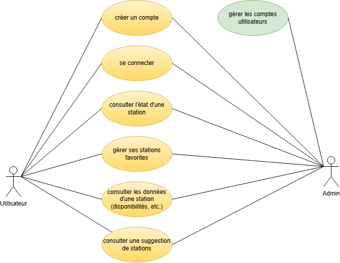
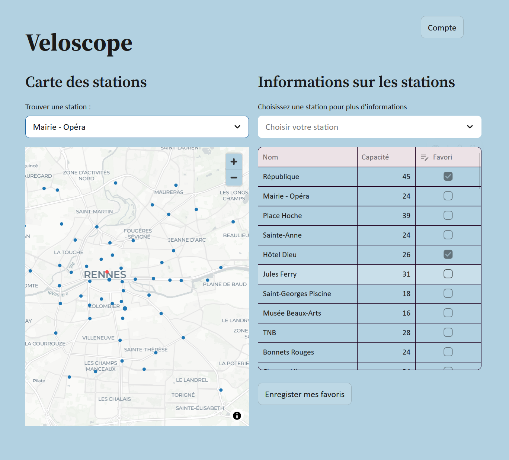
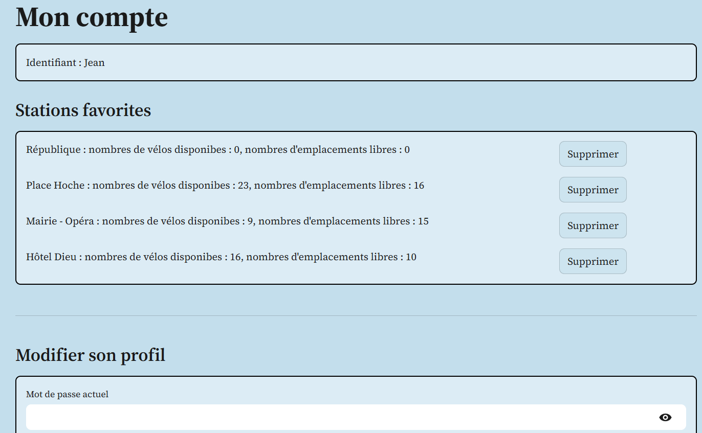
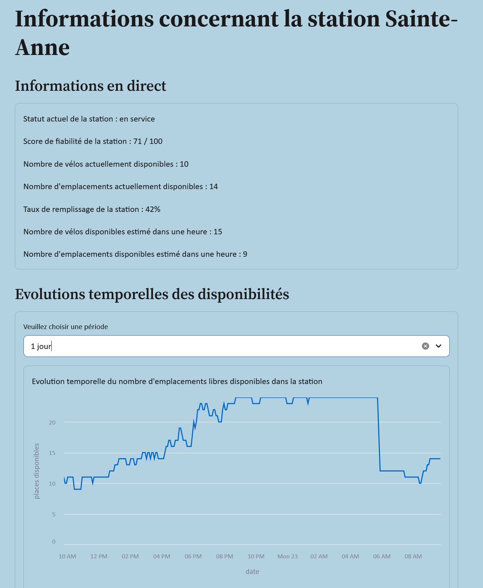
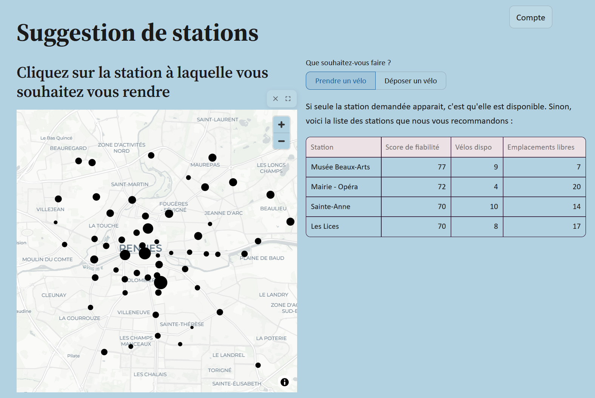
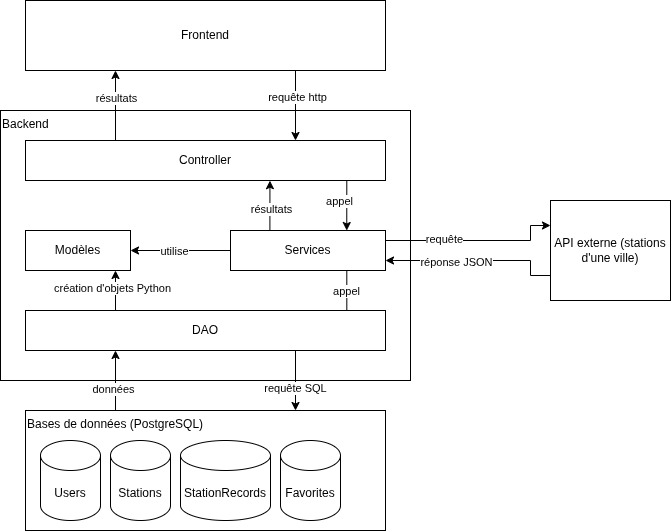
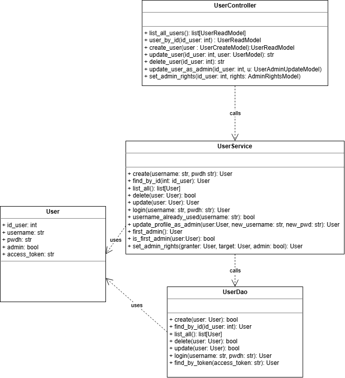
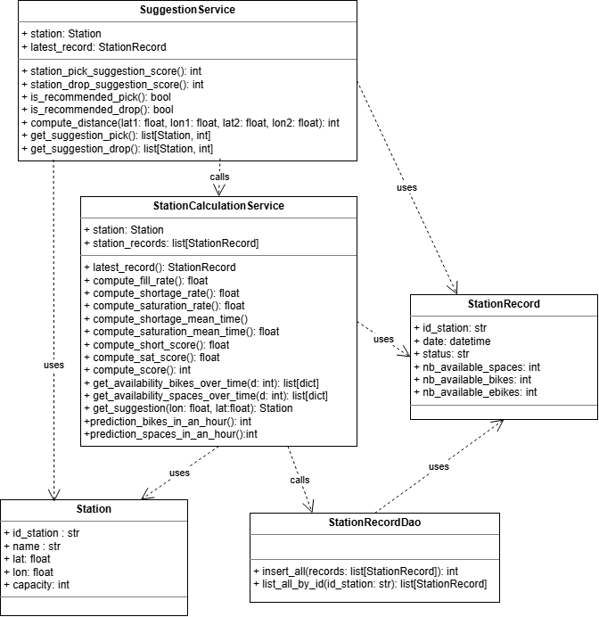
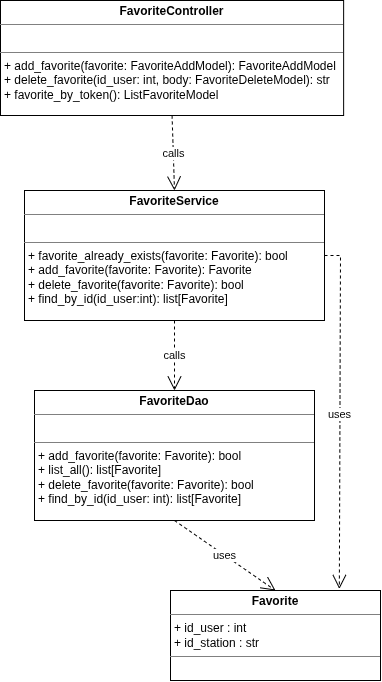

```{=typst}
#import "model.typ": project_template

#show: body => project_template(
  title: [Rapport final : projet VeloScope],
  team: [Équipe 14],
  authors: ([BONAVERO Méline], [BOYCE Eddy], [CHATONNIER Eliot], [LEJARS Samuel], [MOINERAUD--DOUCET Alix]),
  tutor: [RIVIERE André],
  project: [Projet informatique de 2ème année - Année 2026-2027],
  body
)
```

## Introduction  

Face à l'urgence climatique et à la congestion croissante des centres urbains, le développement des mobilités douces s'est imposé comme un pilier de la transition écologique. Au cœur de cette transformation, le vélo connaît un essor sans précédent. Cependant, la détention d'un vélo personnel en milieu urbain se heurte à de nombreuses contraintes : coût d'acquisition élevé, en particulier pour les vélos à assistance électrique, risques de vol ou encore manque d'espace de stockage dans les logements. Afin de démocratiser cette pratique, de nombreuses métropoles, à l'image de Rennes, ont massivement investi dans des réseaux de vélos en libre-service.

Toutefois, l'utilisation quotidienne de ces services révèle une limite récurrente : il est fréquent que les usagers soient confrontés à une station vide aux heures de pointe matinales, ou à des bornes entièrement saturées à destination en fin de journée. Si les applications existantes permettent de consulter l'état du réseau en temps réel, elles souffrent d'une insuffisance structurelle majeure : elles n'offrent qu'une photographie instantanée, figée à l'instant t. Dépourvues de mémoire, elles ne permettent ni d'appréhender les dynamiques récurrentes d'une station, ni d'évaluer sa fiabilité dans la durée, ni d'aider l'usager à anticiper son trajet à court terme.

Afin de pallier ce manque, le projet VeloScope a été conçu dans le cadre du projet informatique de deuxième année. Appliqué au réseau rennais, VeloScope ambitionne de faire évoluer l'usage des vélos en libre-service d'une logique de simple consultation passive vers une véritable aide à la décision. En construisant et en exploitant son propre historique de données, l'application apporte une profondeur temporelle au réseau : elle permet d'analyser le comportement des stations au fil des heures et des jours, afin d'offrir aux usagers une vision fiable et éclairée pour planifier leurs déplacements.

Pour rendre compte de cette démarche, ce rapport s'articule autour de trois grandes parties : il présente tout d'abord le cahier des charges, qui définit le cadre fonctionnel et les attentes autour de l'application, et les solutions appportées. Il détaille ensuite la modélisation technique retenue (architecture, modèle de données, classes et endpoints). Enfin, il expose l'organisation du projet, son calendrier et les outils de développement mobilisés par l'équipe pour mener ce travail à bien. 



## Cahier des charges et solutions apportées  

L'objectif du projet a été de produire une application donnant des informations sur la disponibilité des vélos dans une ville. Au-delà de la seule disponibilité en temps réel par station, l'application devait également fournir d'autres services, tels que des indicateurs temporels et un score de qualité. Voici les fonctionnalités attendues par le *product owner* (pour le détail concernant ces fonctionnalités, voir l'annexe [Cahier des charges détaillé](#cahier-des-charges-détaillé)):  
- F1 : Gestion des utilisateurs  
- F2 : Collecte des données de l'API externe d'une ville  
- F3 : Consultation d'une station  
- F4 : Score de fiabilité des stations  
- F5 : Recommandation de station  
- FO1 : Prévision de disponibilité (fonctionnalité optionnelle)  

<!-- voir annexe pour plus de détails concernant la demande -->

La @fig-cas_utilisation résume les fonctionnalités implémentées.  

{#fig-cas_utilisation}  

Nous détaillons dans les sections suivantes ces fonctionnalités et nos choix de conception les concernant.  

### Gestion des utilisateurs  

Deux types d'utilisateurs sont à distinguer. Il y a tout d'abord les utilisateurs «réguliers» de l'application. Un nouvel utilisateur de l'application est invité à créer un compte afin de pouvoir profiter des autres fonctionnalités. Une fois connecté, il peut accéder aux différentes données de l'application, gérer ses identifiants et gérer ses stations favorites en naviguant à travers les différentes pages de l'application.  

Ensuite, il y a des comptes «administrateurs» qui peuvent gérer les comptes des autres utilisateurs. Ils peuvent ainsi supprimer un compte utilisateur ou élever un utilisateur au rang d'administrateur. Afin d'éviter tout conflit, il a été décidé que la création du premier administrateur se fasse directement dans la base de données sans passer par l'API. Celui-ci doit posséder le plus petit identifiant afin de conserver ses prérogatives sur les autres administrateurs (nous détaillerons ce point dans la section [Classes liées aux utilisateurs](#classes-liées-aux-utilisateurs)).  

### Collecte des données de l'API externe d'une ville  

La collecte des données concernant la disponibilité et l'état des stations de vélos se fait via une API externe d'une ville. Ce type d'API respecte le standard GBFS, c'est-à-dire qu'elle transmet plusieurs fichiers JSON formatés permettant de connaître les stations et leurs disponibilités. Les fichiers qui nous intéressent sont les fichiers ```station_information.json```[^1] (donnant des informations sur les stations) et ```station_status.json```[^2] (donnant des informations sur les disponibilités). Les données de ces fichiers sont collectées toutes les cinq minutes par notre API, afin de conserver une actualisation fréquente et de fournir une application réactive, notamment aux heures de pointes. Les données sont enregistrées dans une base de données hébergée sur un service PostgreSQL qui contient notamment une table pour les stations, et une pour les relevés (voir la section [Couche persistante et modèle de données](#couche-persistante-et-modèle-de-données) pour plus de détails).  

Nous avons fait le choix de travailler avec l'API externe de la métropole de Rennes. La ville de Rennes a la particularité de ne pas posséder de vélos électriques, mais notre implémentation et la standardisation offerte par le format GBFS permettent de pouvoir adapter notre application à l'API d'une ville possédant de tels moyens de transport.  

[^1]: disponible ici : [https://eu.ftp.opendatasoft.com/star/gbfs/station_information.json](https://eu.ftp.opendatasoft.com/star/gbfs/station_information.json). Ce fichier possède les variables d'intérêt suivantes : l'identifiant de la station ```station_id```, son nom ```name```, ses coordonnées géographiques ```lon``` et ```lat```, ainsi que son nombre d'emplacements ```capacity```.  

[^2]: disponible ici : [https://eu.ftp.opendatasoft.com/star/gbfs/station_status.json](https://eu.ftp.opendatasoft.com/star/gbfs/station_status.json). Ce fichier possède les variables d'intérêt suivantes : l'identifiant de la station ```station_id```, le nombre de vélos disponibles ```num_bikes_available```, le nombre d'emplacements libres ```num_docks_available``` et le fait qu'elle soit en service ou non ```is_installed```.  

### Consultation d'une station   

Une fois connecté, l'utilisateur est automatiquement redirigé vers la page des stations. Cette page permet de connaître l'emplacement des stations sur une carte (la pastille de la station se colore).  

{#fig-stations width="93%"}  

Sur cette page, l'utilisateur peut utiliser le tableau afin de cocher ses stations favorites qu'il peut ensuite enregistrer via le bouton en dessous du tableau. L'utilisateur pourra alors, par la suite, accéder directement à la disponibilité en terme de vélos ou d'emplacements libres dans la page "Mes informations".  

{#fig-mesinfos width="93%"}  

Enfin, l'utilisateur peut choisir d'obtenir des informations supplémentaires en sélectionnant une station via une boîte de sélection. La page se recharge et affiche différentes statistiques et informations :  
- le statut et le taux de remplissage de la station,  
- disponibilités actuelles en termes de vélos et d'emplacements,  
- score de fiabilité (voir la section [Score de fiabilité des stations](#score-de-fiabilité-des-stations)),  
- évolution temporelle des disponibilités avec le choix de la fenêtre de temps (dernier jour, dernière semaine ou trente derniers jours),  
- nombre de vélos et d'emplacements estimés dans une heure (voir la section [Prévision de disponibilité](#prévision-de-disponibilité)).  

{#fig-infosstation width="93%"}  

### Score de fiabilité des stations  

Pour chaque station, l'application permet de calculer et fournir un score de fiabilité, traduisant sa capacité à répondre de manière constante aux besoins des usagers. Ces derniers ont deux types de demandes spécifiques. La première est de pouvoir emprunter un vélo dans la station : elle nécessite donc que la station ne soit pas vide. Un score de pénurie ($Spick$) a donc été calculé pour évaluer la capacité de la station à répondre à ce besoin. Ce score prend des valeurs allant de 0 à 1, où le score de 1 est attribué à une station qui n'a connu aucun épisode de pénurie. Le second besoin est de pouvoir déposer un vélo emprunté dans une station, il est alors nécessaire que la station ne soit pas pleine. Un score de saturation ($Sdrop$) est donc calculé en suivant la même logique que le score de pénurie. L'application calcule alors un score global en utilisant ($Spick$) et ($Sdrop$) afin d'obtenir un score de fiabilité sur 100 de la station (le détail du calcul sera présenté en fin de section).  

Pour évaluer cette fiabilité de façon pertinente, on s'appuie également sur l'historique des états de la station sur une période donnée. Pour cela, on calcule un score qui intègre deux dimensions principales : la fréquence d'indisponibilité, mesurée par le pourcentage de temps passé à l'état vide ou saturé, et la durée moyenne des épisodes de pénurie ou de saturation. L'idée est donc de pénaliser la durée des pannes tout autant que leurs fréquences, afin que l'application puisse mettre en avant les stations réellement fiables au quotidien. La séparation du score de fiabilité général en deux sous-scores liés aux besoins spécifiques de l'utilisateur permet dans un second temps, lors de la recommandation de stations, de pouvoir utiliser uniquement le sous-score adapté au besoin réel de l'utilisateur. En effet, la recommandation d'une station à un utilisateur qui souhaite déposer un vélo ne doit pas pénaliser les épisodes de pénurie de la station, l'utilisation d'un sous-score adapté est donc plus pertinent qu'un score général. Cette utilisation supplémentaire conditionne donc ces sous-scores à être compris entre 0 et 1 et non 100 comme l'est le score de fiabilité général.  

La formule de la création des sous-scores tient donc compte des variables suivantes calculées grâce aux enregistrements de la station choisie :  
- la proportion du temps durant lequel la station a été vide ($Pshort$) et pleine ($Pdrop$),  
- les durées moyennes des épisodes de pénurie ($Dshort$) et de saturation ($Dprop$), en secondes.  

La formule d'un sous-score est la suivante (ici appliquée à la pénurie mais similaire au cas de saturation):  
$Spick = (1 - Pshort) ^ 0.5 \times dshort ^ 0.5$  
où $dshort = \exp(-\frac{Dshort}{3600})$ permet de transformer $Dshort$ qui est un temps en secondes en un score sans dimension compris entre 0 et 1, et où 3600 est choisi arbitrairement.  
La formule est de la forme $x ^{(1 - a)} \times y ^ a$ où $a = 0.5$ est choisi afin de pondérer équitablement la proportion du temps d'un épisode à sa durée moyenne. Une formule géométrique a été préférée à une formule arithmétique afin qu'une bonne variable ne puisse pas compenser l'autre si elle est très mauvaise.  

Enfin la formule générale du score de fiabilité est la suivante :  
$S = 100 \times (0.5 \times Spick + 0.5 \times Sdrop)$  
Il est de la forme $(1 - a) \times x + a \times y$ où $a = 0.5$ ici pour donner autant d'importance aux épisodes de pénurie qu'à ceux de saturation.  

### Recommandation de station  

La page "Suggestions de stations" permet de répondre à la demande du cahier des charges de fournir des recommandations de stations à proximité de l'utilisateur. Nous n'avons pas trouvé de moyen permettant de déterminer la localisation de l'utilisateur avec la technologie utilisée. Afin de répondre au cahier des charges, nous avons donc fait le choix de donner à l'utilisateur la possibilité de choisir la station qu'il souhaite utiliser en cliquant sur une carte interactive. Il est ensuite invité à préciser son besoin (prendre où déposer un vélo). Nous détaillons dans la suite le fonctionnement de la méthode ```suggestion_pick``` permettant de retourner les stations suggérées lorsque l'utilisateur souhaite emprunter un vélo.  

{#fig-suggestions width="93%"}  

Tout d'abord, nous construisons un score de recommandation d'une station qui se base à la fois sur la distance à la station sélectionnée ($D$), sur son score de fiabilité de vélos disponibles ($Spick$) et sur le nombre de vélos disponibles lors du dernier relevé ($N$). Voici la formule retenue :  
$Score = 100 \times (d ^ 0.3 \times n ^ 0.5 \times Spick ^ 0.2)$  
où $d = \exp(- \frac{D}{800})$ et $n = 1 - \exp(- \frac{N}{3})$ sont des transformations qui permettent d'obtenir des scores entre 0 et 1 sans unité. Cette formule a nécessité plusieurs choix de conception, les seuils de référence et la valeur des exposants, que nous détaillons ci-dessous.  

Nous avons dû, dans un premier temps, choisir des seuils de référence. Nous avons considéré qu'un nombre de vélos inférieur ou égal à 3 peut poser problème si l'utilisateur ne peut se rendre dans la station que d'ici plusieurs minutes. Une distance trop grande (ici supérieure à 800m) pose un problème similaire.  

Les exposants dans la formule permettent quant à eux de hiérarchiser les paramètres selon l'importance qu'on leur accorde. Nous avons fait le choix de privilégier la possibilité d'obtenir un vélo, au détriment de la nécessité de parcourir une faible distance et du score de fiabilité. Ce choix est justifié par le fait qu'une station ayant de nombreux vélos n'a pas besoin d'avoir un bon score de fiabilité pour répondre aux besoins de l'utilisateur dans un futur proche.  

Pour revenir à l'interface utilisateur, lorsque l'utilisateur sélectionne une station, l'application cherche tout d'abord à déterminer si la station sélectionnée est recommandable. Elle vérifie si elle n'est pas vide et si, dans le cas où elle ne compte qu'un seul vélo, $Spick$ est supérieur à 80. Ce premier filtre cherche à limiter la possibilité de recommander une station vide à l'utilisateur. Si ces deux contraintes sont respectées et si son score de recommandation dépasse 70, elle est alors l'unique station recommandée. Si la station choisie n'est pas recommandable, l'application suggère alors les stations à moins d'un kilomètre de l'utilisateur, possédant au moins deux vélos lors du dernier relevé et un score de recommandation supérieur à 70. Les différentes stations recommandées sont ensuite classées grâce à leur score de recommandation respectif puis affichées dans un tableau.  

### Prévision de disponibilité  

L'application permet de prédire, pour une station donnée, le nombre de vélos et d'emplacements disponibles dans une heure. Pour cela, elle se base sur la moyenne des vélos (respectivement emplacements) disponibles à la même heure le même jour des quatre semaines précédentes. Par exemple, si l'application est utilisée lundi à 12h, la prédiction se basera sur les données des quatre derniers lundis à 13h. La prédiction que nous avons implémentée est toutefois perfectible, puisque le calcul de prédiction ne prend en compte qu'un seul enregistrement par semaine. Statistiquement, cela ne permet pas de prendre en compte la dispersion aléatoire des données et donne donc une estimation instable. Une piste d'amélioration serait de calculer la moyenne de tous les enregistrements sur une plage de 20 min autour de l'heure cible des jours de référence afin de limiter l'aléa d'une estimation ponctuelle.  



### Déroulé de la navigation  

La @fig-activite présente un diagramme d'activité résumant l'implémentation des fonctionnalités et les étapes de navigation dans l'application.  

{#fig-activite width="93%"}   



<!-- **Gestion de compte**  

La partie haute de ce diagramme correspond à la phase de connexion de l'utilisateur. L'utilisateur peut ainsi créer un compte s'il n'en a pas ou se connecter à son compte. Seul un administrateur dispose, après connexion à son compte, de la possibilité d'influer sur les comptes des utilisateurs «réguliers».  

**Fonctionnalités principales**  

L'accès aux fonctionnalités de l'application se situe dans la partie basse du diagramme. L'ensemble des options (recommandations, liste, favoris et recherches) mènent à la consultation des données liées à une seule station. L'utilisateur a ensuite le choix de quitter l'application ou de poursuivre la navigation en retournant à l'étape du choix d'action.  

 -->

## Architecture de l'application  

Le code de l'application a été séparé en plusieurs couches afin de respecter le principe de séparation des responsabilités. L'architecture logicielle retenue est présentée dans la @fig-archi-log. Dans la suite, nous décrivons les choix de conception de ces différentes couches.  

{#fig-archi-log}  

### Frontend  

<!-- I)	Objectifs généraux --> 
L'interface utilisateur de l'application, dont l'implémentation est appelée frontend, est la partie visible et interactive de celle-ci. Elle a pour objectif d'optimiser l'expérience des utilisateurs en leur fournissant un accès intuitif aux données fournies par l'API. Nous avons essayé de rendre la navigation intuitive et interactive, avec de nombreux éléments graphiques (cartes et graphiques interactifs, tableaux récapitulatifs). Nous détaillons dans la suite les choix de conception concernant le frontend.  

L'outil utilisé pour développer le frontend a été la bibliothèque `streamlit`. Il fournit des commandes et des composants d'interface adaptés à nos besoins. De plus, `streamlit` se concentre uniquement sur l'interface graphique (envoi de requêtes et mise en forme des réponses), ce qui permet de respecter la « séparation des préoccupations » (« separation of concerns ») faisant partie des bonnes pratiques de programmation.  
<!-- De plus, en cas de modification du chemin, seul « api_client » sera a changer et il n'y aura pas à modifier toutes les pages individuellement. Cela respecte le principe DRY (« Don't Repeat yourself ») faisant également partie des bonnes pratiques.  -->
<!-- Ce choix se justifie de la manière suivante ; c'est le plus efficace dans sa mise en place permettant de valide rapidement la communication sans complexité excessive. Ensuite, c'est un atout lors du débogage de notre code puisque chaque requête est indépendante et contient toutes les informations nécessaires pour être testée de manière isolée.  -->
<!-- Cela passe par la transformation d'un ensemble de fonctionnalités complexes ; appel de fonctions particulières via une syntaxe précise, en un système intelligible par un utilisateur souvent étranger à la programmation. Ce « système intelligible » repose sur des mécanismes de compréhension simples ; cliquer sur un bouton, visualiser les zones de textes à compléter, ou encore être redirigé automatiquement lorsque certaines actions sont effectuées pour décharger l'utilisateur. 
Le rôle de toute personne réalisant le frontend est de guider au mieux un utilisateur souhaitant effectuer des actions, parfois basiques, afin d'arriver à des fins particulières. Il nous faut faciliter au plus l'accès à l'information recherchée.

Ainsi, dans le cadre de notre projet, les objectifs associés à la partie frontend résident dans le cahier des charges suivant : 
-	Permettre à l'utilisateur de créer aisément son compte, de s'y connecter, et de pouvoir le modifier à tout moment (identifiant et mot de passe). 
-	Une fois connecté, lui montrer des informations globales sur toutes les stations parmi lesquelles on retrouve : une carte avec la localisation de chaque station rennaise, et un tableau récapitulant toutes les stations  
-	Lui permettre de choisir une station précise pour avoir des informations sur celle-ci
-	Montrer toutes les informations relatives à une station de manière fixée (informations en direct), ou sur une période (journalière, hebdomadaire, ou mensuel). Dans le cas des informations temporelles, sera affichée un graphique récapitulant l'évolution des variables considérées ; les emplacements libres et les vélos disponibles. 
-	Donner la possibilité à un utilisateur d'ajouter des stations en favoris afin qu'elles apparaissent sur son profil, lui permettant alors d'avoir accès aux informations relatives à ces stations plus rapidement. 
-	Proposer une section dédiée aux administrateurs afin qu'ils puissent X -->

#### Connexion et gestion de compte  

Les utilisateurs doivent se connecter à l'application pour accéder aux différentes pages. La création de compte ne se faisant qu'une seule fois, il est donc naturel de choisir la page de connexion comme page d'accueil. Ainsi, les utilisateurs n'ayant pas déjà un compte sont invités à changer de page, se créer un compte, puis revenir sur la page de connexion.  

Des choix élémentaires ont été faits au sujet des fonctionnalités de création d'un compte et de connexion. L'utilisateur est amené à rentrer manuellement son identifiant et le mot de passe souhaité. Streamlit permet notamment, via un paramètre « type="password" », de masquer les caractères saisis dans un champ de formulaire sensible. Un bouton cliquable permet d'envoyer la requête qui permettra d'enregistrer le compte ou de vérifier l'authentification.  

Afin que l'utilisateur puisse naviguer entre les pages sans perdre son accréditation, Streamlit propose un outil, nommé « session_state », permettant de conserver des informations lors d'un changement de page (notamment son token d'accès). Il est alors possible pour les utilisateurs d'interagir avec les boutons pour être redirigé vers d'autres pages sans rencontrer de problèmes d'accès. Lors de la déconnexion, les informations contenues dans « session_state » sont supprimées.  

L'application permet également, via la page « Mes informations », de modifier les informations saisies lors de la création du compte par un système de zones de saisie.  

Initialement, nous avions pensé à ne proposer qu'une page de gestion de compte. Celle-ci aurait permis aux utilisateurs de modifier leur profil, et aux administrateurs de pouvoir également accéder à la gestion des comptes des autres utilisateurs. Cependant, la page des administrateurs aurait pu prêter à confusion entre modification d'un compte utilisateur ou modification de son propre compte. Nous avons finalement décidé de séparer la gestion des comptes en deux pages distinctes : une page pour gérer son propre compte, et une page accessible uniquement aux administrateurs. Cela permet une séparation claire des tâches et une navigation facilitée pour les administrateurs.  
<!--Pour ce qui est de l'affichage des droits d'administrateurs, la maquette du frontend réalisée plus tôt suggérait de les incorporer sur la page de compte et ne les afficher que si l'utilisateur était un administrateur. Ce projet a été écarté pour plusieurs raisons ; tout d'abord, cela permet de gagner en clarté lors de l'usage de l'application avec une séparation claire des tâches. Une page trop chargée perd en efficacité et peut perdre l'utilisateur. Ensuite, cela permet de limiter le risque d'erreur lorsqu'on manipule les informations de notre compte, et ainsi éviter de cliquer sur un bouton qui pourrait par exemple supprimer un utilisateur de manière maladroite. -->


<!--Bien qu'on puisse également envisagée que multiplier le nombre de page pourrait ralentir la navigation de l'utilisation ou le perdre, ce choix de séparer les pages semblait être le plus judicieux en pratique. -->


<!-- b.	Fonctionnalités de base 
Nous envisagerons ici les différentes fonctionnalités qui ont été considérés, les problématiques associées, et les décisions qui ont été prises. 
Des fonctionnalités transversales ont été implémentés sur les différentes pages du frontend, à savoir ; (logger, redirections, tout ça) -->

#### Informations sur les stations  

Plusieurs pages permettent d'accéder aux informations des stations fournies par l'application. Initialement, la page de suggestions des stations n'était pas prévue. Les suggestions devaient apparaître directement dans la page «Informations sur les stations». Cependant, cette page aurait nécessité un grand nombre de requêtes au backend, ce qui aurait pu ralentir son chargement. Cela aurait également produit une page lourde en informations et peu ergonomique. Avoir une page de suggestions autonome permet également de faciliter la navigation de l'utilisateur.  

La page contenant les informations des stations a nécessité la mise en place de plusieurs outils graphiques complexes, notamment des cartes et tableaux interactifs, ainsi que des graphiques d'historique. Concernant l'affichage, il était initialement prévu pour être vertical, mais cela ne s'est pas révélé satisfaisant puisque les contenus de la page « Information des stations » sont complémentaires. Nous avons donc retenu un affichage horizontal des composants graphiques, permettant d'avoir accès simultanément aux cartes et au tableau récapitulant les informations.  

Cette page contient également le moyen aux utilisateurs d'ajouter des stations en favoris. L'implémentation de cette fonctionnalité a nécessité un travail de réflexion et d'harmonisation avec le backend, notamment sur le format des schémas utilisés. De plus, il a fallu la rendre intuitive pour l'utilisateur. La solution retenue réside dans la possibilité de cocher ou décocher un ensemble de stations via le tableau listant toutes les stations puis, d'un seul clic, d'enregistrer toutes les modifications. De plus, les stations favorites restent cochées lorsque l'utilisateur revient sur cette page, ce qui lui permet de visualiser rapidement celles qu'il a déjà enregistrées. Une fois les stations enregistrées, les informations les concernant sont rapidement disponibles sur la page « Mes informations ».  

<!-- Pouvoir permettre à un utilisateur d'ajouter des stations en tant que favorites fait partie des fonctionnalités principales de l'applications. La mise en pratique de cette fonctionnalité fût plus complexe qu'initialement envisagé, notamment via des questionnements sur la nature des endpoints associées et la manière dont l'information allait être conservée. Il a également été question de la manière dont les favoris allaient être enregistré ; la première solution envisagée consistait à associer chaque ligne de notre dataframe a un bouton particulier qui, une fois cliqué, ajouterait la station en favori. La solution retenue réside dans la possibilité de cocher ou décocher un ensemble de stations puis, d'un seul clic, d'enregistrer toutes les modifications. Les avantages de cette solution sont, tout d'abord, un nombre bien moindre de requêtes effectuées, une visualisation bien meilleure pour l'utilisateur des stations qu'il a ou non en favori, et une page moins chargée visuellement. 
L'affichage vertical initialement pensé ne s'est pas révélée être satisfaisant puisque le contenu de la page « Information des stations » est complémentaire. Nous avons donc retenu un affichage plutôt horizontal permettant d'avoir accès simultanément aux cartes, et au tableau récapitulant les différentes informations.  
Pourquoi avoir géré les query de cette manière ? 
-->

Concernant l'accès aux données spécifiques d'une station, nous souhaitions initialement pouvoir y accéder par des liens cliquables dans le tableau listant les stations. Cependant, le fonctionnement de Streamlit pour de tels liens entraîne le rafraîchissement de la page, et donc une perte de token (et donc une déconnexion). Nous ne souhaitions pas modifier ce comportement pour des raisons de sécurité (voir la section [La génération et le stockage des tokens](#la-génération-et-le-stockage-des-tokens) pour plus de détails). Nous avons donc décidé de gérer l'affichage des données d'une station en particulier à l'aide de paramètres de requête. Ainsi, la page « Informations sur les stations » possède deux affichages complètement différents, selon qu'elle reçoit un paramètre de requête ou non. Sans paramètre, elle affiche la page générique avec les informations concernant toutes les stations. Cependant, si l'utilisateur choisit une station dans une liste déroulante, l'identifiant de la station est récupéré et envoyé en tant que paramètre de requête tout en relançant la page. La page qui s'affiche est alors celle des données spécifiques à la station. Pour revenir à la page précédente, un bouton « Retour » est prévu.  


<!-- , l'affichage de pages de stations individuelles aurait nécessité de faire 57 pages différentes, cette solution étant loin d'être optimale puisque, dans un premier temps, elle ne respecte pas la bonne pratique « Don't Repeat Yourself », et ensuite, elle rendait toutes modification bien plus complexe. L'ajout d'un graphique, une redirection de page ou encore le changement d'un nom nécessiterait de répercuter cela sur toutes les pages. De plus, puisque les stations peuvent être amenée à évoluer, notre code se doit d'être modulaire afin de s'adapter au mieux à ce qu'est transmis par l'API. Dans le cas où il y aurait de nouvelles stations ou qu'une station fermerait, cela aurait nécessité une maintenance manuelle. Nous avons alors préféré coder une seule page dont le contenu dépendrait d'un paramètre URL qui serait ajusté selon les choix de l'utilisateur (identifiant d'une station et période d'étude des disponibilités). -->


<!--iv.	Afficher les informations des stations 
1.	Carte 
2.	Tableau 
3.	Graphiques d'historique 
v.	Gestion des favoris -->


<!--c.	 Fonctionnalités précises 
i.	Changements de page automatiques 
Dans l'objectif de simplifier les actions l'utilisateur, il a été ajouté à l'application une fonctionnalité de redirection automatique de page en page. Cela se base sur la prévision du parcours classique d'un utilisateur quelconque afin de le guider vers les fonctionnalités qu'il pourrait rechercher. Cette redirection passe par la fonction « switch_page ».
ii.	Afficher des messages d'information suite à des actions précises
Rejoignant la volonté d'améliorer l'expérience utilisateur, il nous est possible d'éclairer l'utilisateur sur la réussite ou non de ses actions via la fonction « success ». Lorsque des pages sont amenées à être rechargées, pour la modification des favoris par exemple, afin que l'utilisateur sache différencier un éventuel bug d'une action normale du site, celui-ci envoie un message informatif quant à l'action précédemment effectuée.  
iii.	Affichage horizontal 

La réalisation de la partie frontend de l'application a amené plusieurs déceptions au sein du groupe, celles-ci concernaient essentiellement les limites techniques permises par une utilisation exclusive et débutante de Streamlit. Un des objectifs fixés était celui de pouvoir recommander à l'utilisateur la station la plus pertinente vis-à-vis de sa position, ce qui s'est révélé être impossible à mettre en place de façon pertinente. Il n'était pas possible de pouvoir incorporer une carte entièrement interactive à l'application, pour pouvoir rendre la carte cliquable il fallait déterminer à l'avance quels points le seraient. Ne pouvant définir des milliers de points et sachant qu'il paraissait peu concevable de demander à l'utilisateur de rentrer sa longitude et latitude exacte sur l'application avant de lui proposer une station, nous avons abandonné cet objectif. Une autre idée qui avait pu être évoquée était celle de la possibilité de recommander un trajet aux utilisateurs de l'application. Cela a été abandonnée puisqu'il n'y avait pas d'outils directement incorporés dans Streamlit nous permettant de faire cela, il aurait fallu connecter une seconde API à notre application ce qui aurait été à la fois plus complexe et chronophage. -->


### Backend  

Le frontend envoie des requêtes HTTP au backend, qui est chargé de traiter ces requêtes et de renvoyer la réponse attendue. Ces requêtes concernent soit la gestion des utilisateurs (création de compte par exemple), soit la gestion des stations de vélos (consultation de la page d'une station par exemple). Le backend a été séparé en plusieurs couches.  

Tout d'abord, une couche controller reçoit les requêtes fournies par le frontend lors de l'utilisation de l'application par un usager. Cette couche a pour but de convertir et transférer ces requêtes à la couche suivante, celle des services.  

La couche service est le cœur de l'application, c'est dans cette couche que sont regroupées les fonctions apportant une valeur ajoutée. Il s'agit par exemple des fonctions permettant de calculer les indicateurs souhaités et le score de fiabilité pour chaque station de vélos. Pour cela, la couche service a besoin de données. Ces services font donc appel à une couche DAO (Data Access Object) afin de communiquer avec les bases de données.  

La couche DAO reçoit les demandes de données de la part de la couche service. Elle est chargée de convertir ces demandes en requêtes SQL. Ces requêtes sont alors traitées par la couche persistante : celle des bases de données. La couche DAO a alors pour mission de convertir les données renvoyées par les bases de données en objets Python (par exemple en objet `User` ou `Station`, voir la section correspondante pour plus de détails). Ces objets sont ensuite utilisés par la couche service afin de calculer les indicateurs. Les résultats obtenus sont transmis à la couche controller puis au frontend pour affichage à l'utilisateur.  

Les choix de conception du backend seront détaillés dans la section [Classes et implémentation du backend](#classes-et-implémentation-du-backend). Le backend a été implémenté avec le framework `FastAPI`, qui permet de mettre en place un système de gestion de requêtes et dont l'architecture nous a été fourni.  

### Couche persistante et modèle de données  

La couche persistante est constituée de bases de données PostgreSQL qu'utilise notre application. Nous avons pour cela dû concevoir un modèle adapté, pérenne et cohérent. Pour nous aider dans cette tâche, nous avons essayé de respecter les trois premières formes normales. Le modèle de données retenu est résumé en @fig-modele_donnees.  

{#fig-modele_donnees}  

Concernant les utilisateurs, une table ```Users``` est nécessaire. Elle contient les données des utilisateurs : identifiant, pseudonyme de l'utilisateur, mot de passe hashé, rôle (utilisateur ou administrateur), ainsi qu'un token d'accès après authentification.  

Pour les stations, les données à stocker sont les suivantes : identifiant et nom de la station, coordonnées géographiques, état de la station, nombre d'emplacements, nombre d'emplacements libres, nombre de vélos disponibles (potentiellement électriques), date (avec heure). Le stockage des données au cours du temps nécessite d'être attentif aux formes normales. En effet, un stockage naïf des relevés dans une seule table nécessiterait une clé composite (```id_station```, ```date```). Cela créerait plusieurs problèmes :  
- l'attribut ```name_station``` serait en dépendance fonctionnelle avec ```id_station``` et donc avec seulement une partie de la clé primaire (contradiction avec le principe de la deuxième forme normale) ;  
- les attributs de coordonnées géographiques ```lon``` et ```lat``` seraient en dépendance fonctionnelle avec ```name_station``` (contradiction avec le principe de la troisième forme normale).  

Pour respecter les trois formes normales, le projet nécessite donc deux tables. La première sera la relation ```Stations```. Ses attributs stockeront les données concernant les stations elles-mêmes : l'identifiant de la station (clé primaire), son nom, ses coordonnées géographiques, le nombre d'emplacements (attribut ```capacity```). La seconde sera la relation ```StationRecords```, qui stockera les données de disponibilités des stations. Ses attributs seront les suivants : l'identifiant de la station (attribut ```id_station```), date et heure de l'enregistrement (```date```), l'état de fonctionnement (```status```), le nombre d'emplacements libres de la station (```nb_available_spaces```), le nombre de vélos disponibles (```nb_available_bikes```) et le nombre de vélos électriques disponibles (```nb_available_ebikes```).  

Enfin, l'un des attendus du projet est de permettre aux utilisateurs de pouvoir gérer leurs stations favorites. Cela se fera via une table d'association ```Favorites``` qui permettra de lier un utilisateur à ses stations favorites.  

Notons pour finir que l'identifiant des stations est de type « chaîne de caractère » car nous le récupérons directement depuis les données fournies par l'API externe au standard GBFS et devons de le conserver tel quel afin de pouvoir adapter facilement notre application à une autre ville.  



## Classes et implémentation du backend  

### Généralités  

L'architecture logicielle présentée en @fig-archi-log nécessite l'implémentation de nombreuses classes Python. Les classes modèles (*business object*) sont les suivantes : ```User```, ```Station```, ```StationRecord``` et ```Favorite``` qui modélisent respectivement un utilisateur, une station, un enregistrement de station à une date précise et la liaison entre un utilisateur et ses stations favorites. Chacune de ces classes nécessite sa propre classe controller, service et DAO afin de pouvoir faire la liaison entre les différentes couches du backend. Nous présentons dans cette section l'ensemble des classes implémentées.  

Nous avons également implémenté plusieurs schémas de type `BaseModel`. Ceux-ci sont utilisés par les controllers et permettent de faire la conversion des objets Python (utilisés par le backend) en données au format JSON (utilisées par le frontend), et inversement. Afin de ne pas surcharger les diagrammes de classes, les schémas n'y figureront pas.  

Enfin, plusieurs éléments nous ont été fournis au début du projet. Parmi ceux-ci figurent notamment la classe `DBConnection`, permettant de se connecter à la base de données grâce à la bibliothèque `psycopg2`, ainsi qu'un ensemble d'utilitaires permettant de gérer l'authentification des utilisateurs, les variables d'environnement et des journaux de logs.  

### Classes liées aux utilisateurs  

Les classes liées aux utilisateurs permettent de créer les comptes, de gérer la connexion et de distinguer deux rôles : utilisateur et administrateur. La classe modèle est `User`. Les autres classes sont fonctionnelles : `UserDao` assure les échanges avec la table de données `Users`, `UserService` regroupe les règles métier (création de compte, connexion, modification d'un profil, gestion des droits administrateur) et `UserController` expose les endpoints correspondants.  

L'authentification repose sur des tokens. Lors de la connexion, l'application génère un token aléatoire, l'enregistre en base avec l'utilisateur et le renvoie au frontend, qui le joint ensuite à chacune de ses requêtes. Les endpoints protégés n'identifient donc pas l'utilisateur à partir d'un `id_user` fourni dans la requête, mais à partir de ce token : un utilisateur malveillant ne peut pas se faire passer pour un autre, notamment pour un administrateur, en modifiant simplement cet identifiant. Ces vérifications sont regroupées dans deux fonctions, `verify_token`, qui exige un utilisateur connecté, et `require_admin`, qui exige en plus un compte administrateur ; chaque endpoint de `UserController` fait appel à l'une ou l'autre selon le niveau d'accès requis.  

Les droits sont ainsi répartis en trois niveaux. Un utilisateur connecté peut modifier son propre profil, à condition de confirmer son mot de passe actuel. Un administrateur peut en plus consulter la liste des comptes, modifier ou supprimer ceux des autres utilisateurs. Enfin, seul le premier administrateur créé peut attribuer ou retirer les droits administrateur, ce qui empêche un administrateur de promouvoir librement d'autres comptes.  

Le diagramme de classes des utilisateurs est présenté en @fig-classes-users.  

{#fig-classes-users}   

### Classes liées aux stations   

La classe modèle ```Station``` est la brique pour de nombreuses fonctionnalités de l'application. Cette classe modélise une station et ses attributs stockent les informations d'une station (nom et identifiant, localisation géographique, capacité). Le controller associé à cette classe permet de retourner les informations de la station avec toutes les statistiques calculées via la méthode ```station_by_id```. Comme les informations d'une station ne sont affichées par le frontend qu'après une sélection de la part de l'utilisateur, il a été fait le choix d'utiliser un modèle, nommé ```StationDataModel``` qui regroupe toutes les informations (aussi bien les informations intrinsèques de la station que les statistiques calculées sur les enregistrements).  

La partie DAO de la classe possède, quant à elle, les méthodes ```create``` et ```update``` qui permettent de créer et mettre à jour la base de données des stations. Cette mise à jour est effectuée à partir des données collectées via l'API externe. Ces méthodes sont appelées par une autre partie du programme, dont nous détaillons l'implémentation dans le paragraphe suivant.  

Le diagramme de classes pour les stations est présenté en @fig-classes-stations.  

{#fig-classes-stations width="97%"}  

### Classes liées à la collecte de données liées aux stations  

Les classes liées à la collecte constituent une pierre angulaire de l'application : ce sont elles qui alimentent la base de données à partir de l'API externe présentée dans le cahier des charges. Il s'agit de ```CollectService```, qui orchestre la collecte, de ```GbfsDao```, qui interroge l'API externe, et des classes ```StationDao``` et ```StationRecordDao```, qui enregistrent en base les objets ```Station``` et ```StationRecord```. Contrairement aux autres fonctionnalités, la collecte n'est pas déclenchée par une requête du frontend : elle est lancée par un script indépendant, ```collector.py```, qui la répète toutes les cinq minutes tant qu'il est en fonctionnement. Le diagramme de classe implémenté, que nous détaillons dans la suite, est présenté en @fig-classes-record.  

{#fig-classes-record width="80%"}    

**L'accès à l'API externe.** La classe `GbfsDao` récupère les deux fichiers JSON que nous avons décrits dans le cahier des charges (`station_information.json` et `station_status.json`). Bien qu'elle n'exécute aucune requête SQL, elle appartient à la couche DAO : son rôle est le même que celui des autres DAO, à savoir fournir des données à la couche service, qui n'a pas à savoir si elles proviennent d'une API ou de la base PostgreSQL.  

**La mise à jour des stations.** À chaque passage, la méthode `refresh_stations` de `CollectService` transforme le fichier `station_information.json` en objets `Station` et les compare à ceux déjà enregistrés. Elle appelle alors les méthodes `create` et `update` de `StationDao` évoquées précédemment : les nouvelles stations sont ajoutées, et celles dont le nom, la position ou la capacité a changé sont mises à jour.  

**L'enregistrement des relevés.** La méthode `collect_records` transforme ensuite le fichier `station_status.json` en objets `StationRecord`. Chaque relevé reçoit la date de collecte, en UTC et identique pour toutes les stations d'un même passage, ainsi qu'un statut calculé à partir de trois indicateurs du flux (`is_installed`, `is_renting` et `is_returning`) : `IN_SERVICE`, `NOT_INSTALLED`, `NOT_RENTING` ou `NOT_RETURNING`. La méthode `insert_all` de `StationRecordDao` enregistre ensuite l'ensemble des relevés ; un relevé déjà présent (même station, même date) est ignoré, ce qui évite les doublons.  

**L'ordre des opérations.** La mise à jour des stations précède toujours l'enregistrement des relevés. En effet, la table `StationRecords` fait référence à la table `Stations` par une clé étrangère (voir @fig-modele_donnees) : un relevé ne peut être enregistré que si sa station existe déjà en base.  

**La robustesse de la collecte.** Une erreur lors d'un passage, par exemple une indisponibilité temporaire de l'API, est enregistrée dans les journaux sans interrompre le script : la collecte reprend au passage suivant.  

**Une limite identifiée.** Les relevés s'accumulent sans jamais être supprimés, à raison d'un relevé par station toutes les cinq minutes, et les stations retirées du réseau restent en base. Une évolution possible consisterait à supprimer automatiquement les relevés au-delà d'une certaine ancienneté afin de respecter un principe de minimisation du stockage des données (actuellement, notre application ne nécessite les données que des trente derniers jours).  

### Classes liées au traitement des données liées aux stations  

Les classes liées au traitement de données correspondent à la valeur ajoutée de l'application par rapport aux données récoltées sur l'API externe. Ces classes sont ```CalculationService``` et ```SuggestionService``` et correspondent respectivement à l'ensemble des méthodes de calcul de statistiques et de scores de fiabilité concernant la station demandée et les méthodes de recommandation d'une station. La @fig-classes-traitement présente le diagramme de classes retenu.  

La séparation en deux classes plutôt qu'une seule classe regroupant tous les calculs repose sur trois arguments. Le premier argument est que chacune donne une signification différente à l'attribut `Station`. Les deux classes reçoivent une `Station`, mais avec un rôle distinct. Dans `CalculationService`, elle désigne la station dont on veut obtenir des statistiques. Dans `SuggestionService`, elle représente la position présumée de l'utilisateur et traduit un besoin réel de sa part.  

Le deuxième argument est que chaque classe possède des besoins en données différents. `CalculationService` nécessite l'ensemble des `StationRecord` de la station (via `list_all_by_id` du DAO) pour calculer ses indicateurs statistiques. `SuggestionService`, lui, ne manipule directement que le dernier enregistrement pour déterminer le nombre de places ou de vélos disponibles, et délègue à `CalculationService` les calculs qui exigent l'historique complet.  

Le troisième argument est de fournir une dépendance à sens unique et une meilleure maintenabilité. `SuggestionService` s'appuie sur `CalculationService`, mais l'inverse n'est pas vrai. Cette séparation respecte le principe de responsabilité unique : chaque classe a une seule raison d'être. Elle facilite aussi les tests, puisqu'on peut isoler `SuggestionService` en simulant `CalculationService`, et évite une classe unique trop volumineuse.  

{#fig-classes-traitement width="100%"}   

Voici la façon dont nous avons conçu la classe `CalculationService`. Tout d'abord une méthode `latest_record` permet de sélectionner uniquement le dernier enregistrement qui sera utile dans certaines méthodes des deux classes de calcul. La classe possède ensuite toutes les méthodes relatives au calcul de score de fiabilité. Les premières méthodes correspondent à la création de variables et les dernières leur utilisation pour arriver aux scores de fiabilité. Enfin, les méthodes d'évolution de disponibilité et de prédiction sont aussi dans cette classe de par leur nature similaire de traitement statistique des données.  

Décrivons maintenant la classe `SuggestionService`, qui dispose de trois types de méthodes (`station_pick/drop_suggestion_score`, `compute_distance`, `get_suggestion_pick/drop`). Rappelons que l'utilisateur sélectionne initialement une station à laquelle il souhaite se rendre. Les méthodes `get_suggestion_pick/drop` permettent, dans un premier temps, de vérifier si la station sélectionnée passe des critères d'éligibilité. Si c'est le cas, c'est cette station qui est suggérée. Sinon, ces méthodes appellent les méthodes `station_pick/drop_suggestion_score` qui vérifie l'éligibilité de toutes les autres stations. Enfin la méthode `compute_distance` calcule la distance entre deux points en utilisant leurs coordonnées géographiques, ce qui permet de ne pas suggérer de stations trop éloignées. Cette méthode permet notamment de ne pas dupliquer du code et améliore la lisibilité des autres méthodes qui sont déjà de taille conséquente.  

<!-- La première correspond au calcul du score de recommandation de la station séléctionnée tandis que la dernière calcule celui de toutes les autres stations dans le cas où l'on ne retient pas la station choisie. Ce choix a été fait en présupposant que l'utilisateur avait une localisation très proche de la station qu'il choisit. N'ayant pas la possibilité de récupérer directement la localisation de son appareil, on utiliserait ainsi la localisation de la station comme tel. De plus ces conditions vérifiées, l'utilisateur aurait tout intérêt à aller dans cette station si elle s'avère recommandable. Ainsi les méthodes `get_suggestion_pick/drop` vérifient dans un premier temps si la station est éligible avant de faire le calcul des scores de recommandation des autres stations. On renvoit donc que la station séléctionnée avec son score si elle est éligible puisque l'utilisateur n'a pas besoin de savoir si d'autres station sont recommandables du moment quelle celle-ci l'est. Enfin la méthode `compute_distance` calcule la distance entre deux points en utilisant leur coordonnées géographique. Ce calcul aurait lui aussi pu être inclut dans les dernière méthode mais il aurait du être fait deux fois (une dans chaque `get_suggestion`) et aurait impacter la lisibilité des dernières méthodes qui sont déjà de taille conséquente. -->

L'implémentation de ces classes pourrait être nettement améliorée. En effet, actuellement, `SuggestionService` instancie systématiquement `CalculationService`, ce qui charge l'ensemble des `StationRecord` même lorsque seul le dernier enregistrement est utile. Une évolution possible consisterait à n'obtenir de la couche DAO que le dernier enregistrement (par exemple via `find_latest_by_id`) et à n'instancier `CalculationService` que pour les méthodes qui en ont réellement besoin. De plus, plusieurs méthodes de calcul de scores sont dupliquées (une fois pour l'état de saturation une fois pour la pénurie). Ceci ne respecte pas les bonnes pratiques, mais le temps nous a manqué pour concevoir un *design pattern* adapté.  

### Classes de gestion des stations favorites  

La nécessité d'une table de liaison ```Favorites``` dans la base de données nous a amenés à implémenter une classe ```Favorite``` dont les attributs sont un identifiant station et un identifiant utilisateur. Les classes associées (controller, service et DAO) sont essentiellement techniques et permettent à l'utilisateur d'ajouter et de supprimer ses stations favorites dans la base de données. La classe FavoriteController possède notamment la méthode `favorite_by_token`, qui permet de renvoyer la liste des stations favorites d'un utilisateur connecté en utilisant son token. La @fig-classes-favorite présente le diagramme de classes associé à ces classes.  

{#fig-classes-favorite width="45%"}   



### Description des endpoints  

Les tableaux suivants décrivent les différents endpoints de l'application. Les sorties sont gérées par des schémas `pydantic`.  

#### Comptes et authentification  

| Chemin | Méthode | Entrée | Sortie (succès) | Description |
| :---- | :---- | :---- | :---- | :---- |
| `/user` | POST | `username`, `password` | `User` | Crée un compte |
| `/user` | GET | token d'admin | Retourne la liste des utilisateurs |
| `/user/   {id_user}` | GET | token admin | `User` | Informations de l'utilisateur |
| `/user/   {id_user}` | DELETE | token admin | - | Supprime un compte |  
| `/user/   {id_user}` | PUT | `username`, `password`, token admin | `User` | Modifie un utilisateur (admin) |
| `/user/{id_user}/me` | PUT | `username`, `password`, token | `User` | Modifie un utilisateur |
| `/user/{id_user}/admin` | PUT | `username`, `password`, token admin | `User` | Donne droits admin |
| `/login` | POST | `username`, `password` | jeton d'accès | Authentifie et renvoie un jeton |

#### Stations  

| Chemin | Méthode | Entrée | Sortie (succès) | Description |
| :---- | :---- | :---- | :---- | :---- |
| `/station` | GET | - | `liste[Station]` | Liste les stations |
| `/station/{id_station}` | GET | période | données | Renvoie toutes les informations de la station |
| `/station/suggestions/{id_station}` | GET | dépôt/retrait vélos | `liste[Station]` | Retourne les stations recommandées |
| `/station/{id_station}/latest` | GET | - | `StationRecord` | Retourne le dernier relevé |

#### Gestion des stations favorites  

| Chemin | Méthode | Entrée | Sortie (succès) | Description |
| :---- | :---- | :---- | :---- | :---- |
| `/favorite` | POST | `Favorite` | `Favorite` | Ajoute une station favorite |
| `/favorite` | GET | token | `liste[Favorite]` | Retourne la liste des favoris de l'utilisateur |
| `/favorite/{id_user}` | DELETE | `id_station` | - | - | Retire une station des favoris |  

### Diagramme de séquence d'une fonctionnalité  

Nous venons de présenter l'architecture de notre application. Afin de résumer toutes ces informations, la @fig-sequence présente le diagramme de séquence de la fonctionnalité «ajouter une station favorite» lorsque la station n'est pas déjà en favori.  

{#fig-sequence}  

### Gestion de la sécurité de l'application  

La sécurisation d'une application est un enjeu important. Nous avons identifié plusieurs risques, auxquels nous avons tenté d'apporter des réponses.  

#### Le hachage des mots de passe  

Le modèle de projet fourni proposait un hachage salé des mots de passe, avec la fonction SHA-256 et le nom d'utilisateur comme sel. Le sel empêche l'utilisation de tables de hachage précalculées génériques lors d'un potentiel vol de données : deux utilisateurs ayant le même mot de passe n'ont pas le même hash en base.  

Ce choix présente toutefois des limites. Le nom d'utilisateur est un sel prévisible et identique d'un site à l'autre, ce qui permet de préparer une attaque à l'avance pour des noms courants comme ```admin```. Surtout, SHA-256 est une fonction très rapide, ce qui facilite les attaques par force brute en cas de fuite de la base. Enfin, le hash dépendant du nom d'utilisateur, il doit être recalculé à chaque changement de nom : l'application demande donc le mot de passe actuel lorsqu'un utilisateur modifie son nom, et impose un nouveau mot de passe lorsqu'un administrateur souhaite modifier le nom d'un autre utilisateur.  

Plusieurs pistes d'amélioration pourraient être envisagées : un sel aléatoire généré à la création du compte et stocké en base, un algorithme volontairement lent comme bcrypt et l'ajout d'un poivre (un secret stocké hors de la base). Faute de temps, elles n'ont pas été mises en œuvre.  

#### La génération et le stockage des tokens  

Lors de la connexion, l'application génère un token avec ```secrets.token_urlsafe(32)```, un générateur cryptographique qui le rend impossible à deviner. Ce token est stocké dans la table ```Users``` jusqu'à la connexion suivante, qui le remplace. Côté frontend, il est conservé dans la session Streamlit, sur le serveur, et n'est jamais enregistré dans le navigateur : un script malveillant injecté dans la page ne peut donc pas le récupérer. La contrepartie est la déconnexion lors d'un rafraîchissement de la page. Ainsi, un utilisateur ne peut rentrer directement une adresse URL pour lancer une requête API ou accéder à un endpoint auquel il ne devrait pas avoir accès.    

Notre implémentation a plusieurs limites. Le token n'a pas de date d'expiration : s'il est volé, il reste valable indéfiniment. Il est stocké en clair, si bien qu'une fuite de la base donnerait accès à toutes les sessions ouvertes. Un utilisateur ne peut avoir qu'une session à la fois, puisqu'une nouvelle connexion invalide la précédente. Enfin, la colonne ```access_token``` n'est pas indexée : la recherche d'un utilisateur par son token parcourt toute la table, ce qui ralentirait les requêtes avec un grand nombre d'utilisateurs.  

Un index sur cette colonne suffirait à résoudre le problème de performance. Pour les autres limites, une table dédiée aux sessions, stockant une empreinte du token plutôt que le token lui-même, permettrait de gérer une date d'expiration, une déconnexion après une période d'inactivité et plusieurs connexions simultanées.  

#### L'identification par token plutôt que par identifiant  

Les endpoints protégés identifient l'utilisateur à partir du token transmis par le frontend dans l'en-tête ```X-Auth-Token```, et non à partir d'un ```id_user``` fourni dans la requête. Un utilisateur ne peut donc pas agir sur le compte d'un autre en modifiant simplement cet identifiant. Ce contrôle est effectué à chaque appel par les fonctions ```verify_token``` et ```require_admin``` présentées avec les classes liées aux utilisateurs. Seuls les endpoints d'ajout et de suppression de favoris ne l'appliquent pas encore.  

#### La protection de la base de données  

Toutes les requêtes SQL des classes DAO sont paramétrées : les valeurs fournies par l'utilisateur ne sont jamais insérées directement dans le texte de la requête, ce qui protège l'application contre les injections SQL. Les données reçues sont par ailleurs validées par les schémas Pydantic adaptés à chacune des requêtes, et les réponses de l'API ne renvoient jamais le hash du mot de passe ni le token.  

#### La gestion des droits administrateurs  

Les administrateurs sont des utilisateurs de la table ```Users``` dont l'attribut ```admin``` est vrai. Ils peuvent consulter la liste des comptes, ainsi que modifier ou supprimer ceux des autres utilisateurs.  

En revanche, seul le premier administrateur, défini comme l'administrateur ayant le plus petit identifiant, peut attribuer ou retirer les droits administrateur. Cela évite une propagation incontrôlée des droits et empêche un administrateur de retirer ceux des autres. Ce premier administrateur est lui-même protégé : il ne peut ni perdre ses droits, ni voir son profil modifié ou son compte supprimé par un autre administrateur.  



## Organisation du projet  

### Organisation du groupe  

Dès la première séance, nous avons décidé de créer un groupe sur l'application WhatsApp qui nous a permis de communiquer de manière réactive durant tout le projet. C'est également durant cette séance que nous avons mis en place le dépôt GitHub. Nous avons également mis en place des règles basiques afin d'éviter les conflits sur le dépôt. Par exemple, chaque membre du groupe n'avait le droit de modifier que les fichiers qui lui étaient attribués. Pour les fichiers communs, nous devions prévenir lorsque l'on travaillait dessus. Cette organisation nous a été bénéfique car nous n'avons pas relevé de conflits majeurs durant toute la phase de développement du projet.  

Concernant la répartition des tâches, nous avons communiqué assez tôt sur nos appétences respectives mais nous avons décidé d'attendre quelques séances pour distribuer les rôles. Cette distribution s'est faite naturellement lors des premières séances. Ainsi, Eddy est devenu chef de projet tandis que l'appétence d'Eliot pour les sujets techniques et la cybersécurité l'ont amené à prendre le rôle de *technical leader*. Samuel s'est montré très vite intéressé pour devenir développeur backend, notamment sur la partie service du traitement des données. Enfin, Alix et Méline ont souhaité s'orienter vers le rôle de développeur frontend. Cependant, ces rôles n'étaient pas figés et nous nous sommes laissé la possibilité d'intervenir sur différentes parties en fonction des intérêts du moment.  

### Organisation temporelle  

Le calendrier prévisionnel communiqué lors du rapport intermédiaire est donné ci-dessous par le diagramme de Gantt en @fig-diag_gantt.  

Ce calendrier a été respecté durant la majeure partie du développement. Cependant, un léger retard dans la rédaction du rapport et une accumulation de contraintes scolaires après la semaine des vacances d'octobre nous a amenés à précipiter la fin du projet et à ne pas peaufiner le code autant que nous l'aurions souhaité. Cela a été pour nous d'autant plus frustrant que nous n'avons pas pu profiter du temps que nous avions en début de projet car nous n'avions pas encore acquis les connaissances nécessaires pour avancer le développement.  

{#fig-diag_gantt width="92%"}  

### Outils de développement  

Le projet a été réalisé en Python. Durant la phase de développement, nous avons utilisé plusieurs outils et bibliothèques fournis pour ce langage. Voici le détail de ces outils pour chaque couche :  
- le framework ```Streamlit``` pour le frontend,  
- le framework ```FastAPI``` pour le backend,  
- la bibliothèque ```psycopg2``` pour la couche DAO (afin de convertir les instructions Python en requêtes lisibles par les tables PostgreSQL),  
- la bibliothèque ```pydantic``` pour les classes schéma.  


De plus, afin de garantir une maintenance aisée, nous avons tenté de respecter les bonnes pratiques de programmation. Ainsi, le code et la documentation ont été rédigés en anglais. De plus, nous avons utilisé les outils suivants :  
- Ruff pour le formatage du code,  
- Pytest afin d'effectuer les tests unitaires,   
- GitHub pour héberger et versionner notre projet.  

### Stratégie de tests  

Nous n'avons pas mené notre projet en *Test-Driven Development*. Cependant, conscients de la nécessité d'une grande rigueur lors de la phase de développement du backend, nous avons écrit toutes les signatures des méthodes avant de commencer à les implémenter, et ce afin de vérifier la cohérence des méthodes et du typage. Cela nous a permis d'éviter de nombreux écueils lors de la phase de codage du backend. De plus, nous avons mis en place les tests unitaires directement après avoir implémenté les classes, sans attendre que toutes les fonctionnalités ne soient effectives.  

Afin de tester le bon fonctionnement de notre application, nous avons implémenté des tests à l'aide de Pytest pour les méthodes de classes services dès la fin de l'implémentation de celles-ci. Pour cela, il nous a été nécessaire d'utiliser la classe ```MagicMock``` afin de simuler le comportement de la couche DAO. Concernant cette dernière, nous n'avons pas implémenté de tests via Pytest, car cela aurait nécessité la mise en place d'une base de données factice en parallèle de la véritable base de données. Cependant, durant la phase de codage du backend et avant le début de la mise en place de la collecte de données, nous avons utilisé une base de données factice afin de vérifier le bon fonctionnement des différents endpoints.  

Certaines fonctions ont été modifiées afin de permettre d'être testées plus facilement. Par exemple, dans `CalculationService`, les méthodes `get_availability_bikes/spaces_over_time` utilisent un paramètre `now` qui est initialisé à `None` par défaut. L'application en soi n'utilise pas ce paramètre et le laisse en `None`, puisqu'elle utilise l'heure actuelle (`datetime.now(UTC)`) comme date de référence pour obtenir l'historique des disponibilités. Cependant, les tests s'appuient sur des données figées ne se renouvelant pas, il n'était donc pas possible d'utiliser la date actuelle comme date de référence. Le paramètre `now` est donc appelé pour choisir une date adaptée à ces données de tests.  

### Usage de l'IA  

Conscients que ce projet était pour nous l'occasion de développer nos connaissances et nos compétences, nous avons tenu à encadrer notre utilisation de l'intelligence artificielle. Nous avons ainsi convenu de ne l'utiliser pour des tâches de production qu'à titre exceptionnel et après en avoir informé les autres membres du groupe. Elle nous a cependant été d'une grande aide lorsqu'il a fallu trouver des solutions techniques pertinentes, notamment lors du développement de la collecte de données via l'API externe et de l'implémentation du frontend. Elle a également été très utile afin de réduire le temps de débogage.  

## Conclusion et pistes d'améliorations  

L'application VeloScope est devenue réalité au cours de ce projet. Ce dernier a été l'occasion de découvrir le développement complet d'une application, de la conception au développement, du backend au frontend. Nous avons ainsi eu l'occasion de construire un modèle de données et l'architecture logicielle permettant de l'exploiter. Nous avons dû réfléchir et mettre en œuvre des solutions techniques aux demandes du cahier des charges. Ce projet nous a également initié aux questions de sécurisation intrinsèque au développement d'une API.  

Durant ce projet, nous nous sommes rendus compte des contraintes qui s'appliquent à la production d'une application. Ainsi, les technologies employées n'ont pas toujours permis de répondre exactement au cahier des charges, notamment pour la suggestion des stations. En effet, nous n'avons pas trouvé de moyen pertinent et aisé à mettre en œuvre afin de récupérer la position géographique de l'utilisateur. Nous avons cependant tenté de répondre aux besoins client en fournissant une solution techniquement réalisable avec les technologies utilisées et dans le temps imparti.  

Au cours de ce rapport, nous avons eu l'occasion de discuter des différentes pistes d'amélioration techniques et localisées. Il y a également des améliorations plus profondes ou qui nécessiteraient la mise en place de nouvelles fonctionnalités. Par exemple, les graphiques de disponibilités des stations montrent parfois des chutes brutales durant une période de collecte. Après étude des bases de données, nous nous sommes rendu compte que cela est dû à des anomalies de l'API externe qui considère la station comme « hors service », la situation revenant à la normale à la collecte suivante. Nous pourrions donc tenter de relever ces anomalies en repérant les changements éphémères de statut de la station. Cela nécessiterait alors une estimation du nombre de disponibilités durant ce défaut de fonctionnement.  

De plus, ce projet ayant été développé par différents membres et alors que nous étions encore en cours d'apprentissage, les techniques employés ne sont pas nécessairement harmonisées. Par exemple, les appels des classes controller aux classes de services pourraient être améliorés en harmonisant les pratiques d'instanciation des classes services.  

Pour conclure, ce projet a été pour nous riche en apprentissages et en développement de compétences. Il nous a ainsi permis de développer aussi bien nos compétences techniques et que nos compétences organisationnelles. Enfin, nous souhaitons remercier notre tuteur pour nous avoir permis de le mener à bien.  



## Annexes  

### Cahier des charges détaillé  

*Présentation du sujet*  
Les vélos en libre-service sont disponibles en temps réel dans de nombreuses villes. Pourtant, une simple carte des stations ne permet pas vraiment de répondre à des questions utiles : À quelle heure vais-je réellement trouver un vélo ? Quelles stations sont souvent pleines ? Quels trajets sont les plus fiables ? Est-ce qu’une station est régulièrement vide le matin mais pleine le soir ? Le projet VeloScope consiste à développer une API permettant de collecter, historiser et analyser les données de vélos en libre-service d’une ville. L’application récupère périodiquement les informations d’une API de vélos en libre-service compatible avec le standard GBFS : stations, nombre de vélos disponibles, nombre de places libres, vélos électriques, etc. Contrairement à une simple application de consultation, VeloScope doit construire son propre historique afin de permettre des analyses temporelles et de produire des indicateurs de fiabilité des stations.  

*Fonctionnalités obligatoires implémentées*  
- F1 : Gestion des utilisateurs. Un utilisateur peut : créer un compte, se connecter, consulter les données et statistiques, gérer ses stations favorites. Un compte ADMIN peut gérer les utilisateurs.  
- F2 : Collecte des données. L’application doit interroger régulièrement l’API GBFS choisie et récupérer les informations des stations. Pour chaque relevé, on stockera notamment : station, date et heure, nombre de vélos disponibles, nombre de places disponibles, nombre de vélos électriques, état de la station. Les données récupérées doivent être historisées en base PostgreSQL. L’application ne doit pas simplement remplacer les valeurs précédentes : elle doit permettre de reconstruire l’état du réseau à différents instants.  
- F3 : Consultation d’une station. L’utilisateur peut rechercher une station et consulter : son état actuel, son nombre de vélos disponibles, sa capacité, son taux de remplissage, l’évolution de sa disponibilité sur une période donnée. L’utilisateur doit notamment pouvoir choisir une période : dernières 24 heures, 7 derniers jours, 30 derniers jours.  
- F4 : Score de fiabilité des stations. C’est la fonctionnalité métier principale. Pour chaque station, l’application calcule un score de fiabilité. Par exemple, une station est considérée comme : vide lorsqu’il n’y a plus de vélo disponible, saturée lorsqu’il ne reste plus de place, fonctionnelle dans les autres cas. À partir de l’historique, l’application calcule notamment : pourcentage du temps passé vide, pourcentage du temps passé saturé, durée moyenne des épisodes de saturation, durée moyenne des épisodes de pénurie, évolution du score au cours du temps. Le score global est défini par les étudiants à partir d’une formule documentée.  
- F5 : Recommandation de station. Lorsqu’un utilisateur demande : « Je veux prendre un vélo à proximité » l’API doit être capable de lui proposer plusieurs stations pertinentes. La recommandation doit prendre en compte plusieurs critères, par exemple : distance, nombre de vélos actuellement disponibles, fiabilité historique de la station, disponibilité de vélos électriques, tendance récente de la station. Deux stations à distance équivalente ne doivent donc pas nécessairement être classées de la même manière. La formule de classement devra être justifiée et testée.  

*Fonctionnalités optionnelles implémentée*  
- FO1 : Prévision de disponibilité. À partir de l’historique, tenter d’estimer la probabilité qu’une station soit vide ou saturée dans les prochaines heures. Il est possible de commencer avec un modèle statistique très simple avant d’utiliser une approche plus avancée.  

Les autres fonctionnalités optionnelles proposées par le sujet n'ont pas été implémentées.  

 

### Note individuelle : Méline BONAVERO  


 

### Note individuelle : Eddy BOYCE  

Durant ce projet, j'ai endossé le rôle de chef de projet. Ce choix a été naturel puisque j'avais l'habitude de gérer des projets de par mon expérience professionnelle antérieure. J'ai apprécié ce rôle car mes camarades étaient réactifs aux demandes. L'entente du groupe a été bonne et a permis d'avancer régulièrement sur le projet dans une ambiance sereine.  

Ce rôle m'a permis d'aborder tous les sujets du projet. Je me suis tout d'abord consacré à l'architecture logicielle. Cette part du projet a été gratifiante car elle m'a permis de découvrir l'univers des API, tout en consolidant mes compétences en architecture logicielle acquises lors du projet informatique de première année. Cela m'a permis d'avoir une vision d'ensemble du projet et de pouvoir coordonner la rédaction des rapports ainsi que la production des différents diagrammes.  

J'ai également eu l'occasion de participer à l'implémentation de certaines parties (une partie de la gestion des utilisateurs, les classes concernant les stations favorites et leurs tests, la mise en place du frontend et son articulation avec le backend). Ce rôle a donc été très riche et m'a permis de développer de nombre J'ai donc eu l'occasion d'assimiler beaucoup de connaissances concernant l'implémentation d'une application, de l'interface utilisateur aux bases de données en passant par le backend.  

 

### Note individuelle : Eliot CHATONNIER  


 

### Note individuelle : Samuel LEJARS  


 

### Note individuelle : Alix MOINERAUD--DOUCET  