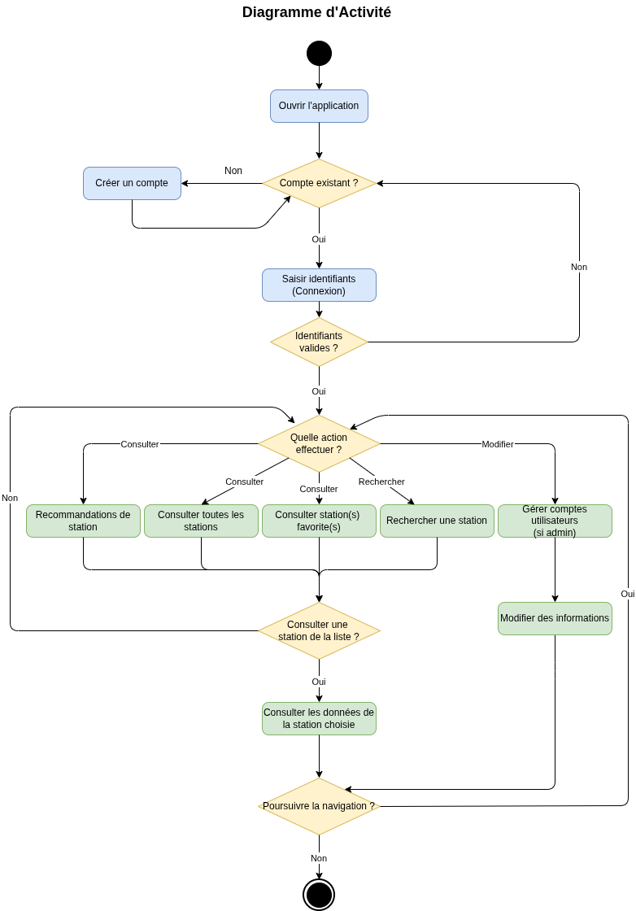
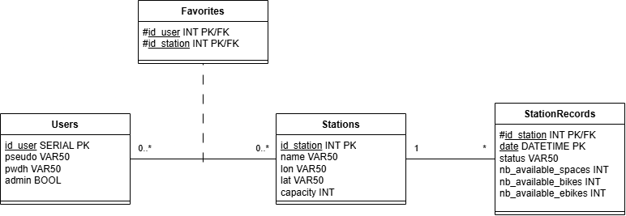
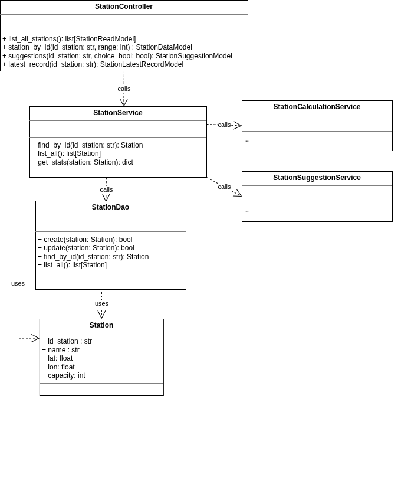
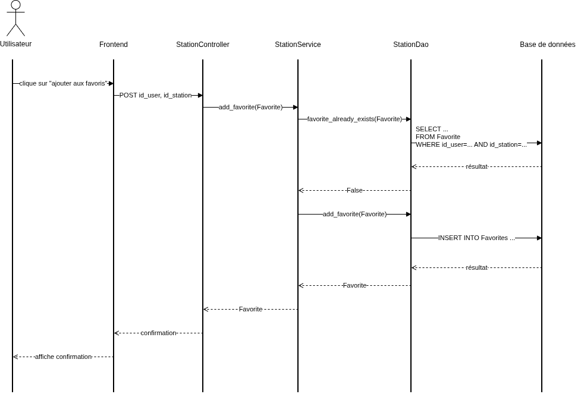
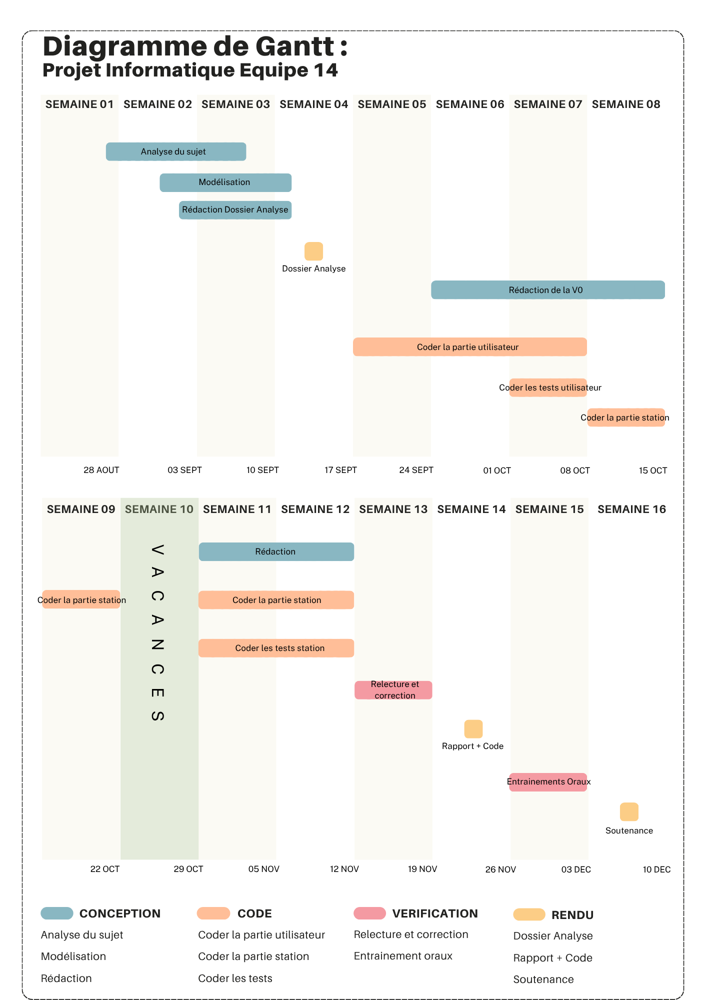

```{=typst}
#import "model.typ": project_template

#show: body => project_template(
  title: [Rapport final : projet VeloScope],
  team: [Équipe 14],
  authors: ([BONAVERO Méline], [BOYCE Eddy], [CHATONNIER Eliot], [LEJARS Samuel], [MOINERAUD--DOUCET Alix]),
  tutor: [RIVIERE André],
  project: [Projet informatique de 2ème année - Année 2026-2027],
  body
)
```

## Introduction  

Face aux enjeux du dérèglement climatique, le développement des mobilités douces s'impose comme un axe majeur de transition, avec le vélo au premier plan. Toutefois, l'accès à un vélo personnel reste freiné par plusieurs contraintes socio-économiques et pratiques, telles que le coût d'achat, particulièrement pour les vélos électriques, ou le manque d'espace de stockage en milieu urbain. Pour pallier ces difficultés, de nombreuses collectivités, à l'image de la ville de Rennes, se sont dotées d'un réseau de vélos en libre-service dont la bonne gestion des stations est essentielle.

Si des applications permettent déjà de consulter l'état des stations en temps réel, elles présentent une limite majeure : elles n'offrent qu'une photographie instantanée du réseau, sans recul historique. Il est ainsi difficile pour un usager d'évaluer la fiabilité d'une station dans la durée ou d'anticiper la disponibilité d'un vélo à court terme. C'est pour répondre à cette problématique qu'a été conçu VeloScope, dans le cadre du projet informatique de deuxième année.

Appliqué au réseau rennais, VeloScope a pour ambition de dépasser la simple consultation en temps réel en s'appuyant sur l'historisation des données des stations. L'objectif est d'offrir aux utilisateurs une vision plus fine de l'évolution des stocks dans le temps afin de les aider à mieux anticiper leurs déplacements.

Ce rapport est structuré en trois grandes parties : il présente tout d'abord le cahier des charges définissant le cadre fonctionnel du projet, détaille ensuite la modélisation retenue (architecture, données, classes et endpoints), puis expose l'organisation du projet ainsi que les outils mis en œuvre par l'équipe.



## Cahier des charges

L'objectif du projet a été de produire une application donnant des informations sur la disponibilité des vélos dans une ville. Au-delà de la seule disponibilité en temps réel par station, l'application devait également fournir d'autres services, tels que des indicateurs temporels et un score de qualité. Voici les fonctionnalités attendues par le *product owner* :  
- F1 : Gestion des utilisateurs  
- F2 : Collecte des données de l'API externe d'une ville  
- F3 : Consultation d’une station  
- F4 : Score de fiabilité des stations
- F5 : Recommandation de station
- FO1 : Prévision de disponibilité (fonctionnalité optionnelle)

<!-- voir annexe pour plus de détails concernant la demande -->

La @fig-cas_utilisation résume les fonctionnalités implémentées.  

{#fig-cas_utilisation}  

Nous détaillons dans les sections suivantes ces fonctionnalités et nos choix de conception les concernant.  

### Gestion des utilisateurs  

Deux types d'utilisateurs sont à distinguer. Il y a tout d'abord les utilisateurs «réguliers» de l'application. Un nouvel utilisateur de l'application est invité à créer un compte afin de pouvoir profiter des autres fonctionnalités. Une fois connecté il peut accéder aux différentes données de l'application, gérer ses identifiants et gérer ses stations favorites en naviguant à travers les différentes pages de l'application. 

Ensuite, il y a des comptes «administrateurs» qui peuvent gérer les comptes des autres utilisateurs. Ils peuvent ainsi supprimer un compte utilisateur ou élever un utilisateur au rang d'administrateur. Afin d'éviter tout conflit, il a été décidé que la création du premier administrateur se fasse directement dans la base de données sans passer par l'API. Celui-ci doit posséder le plus petit identifiant afin de conserver ses prérogatives sur les autres administrateurs.  

### Collecte des données de l'API externe d'une ville  

La collecte des données concernant la disponibilité et l'état des stations de vélos se fait via une API externe d'une ville. Ce type d'API respecte le standard GBFS, c'est-à-dire qu'elle transmet plusieurs fichiers JSON formatés permettant de connaître les stations et leurs disponibilités. Les fichiers qui nous intéressent sont les fichiers ```station_information.json```[^1] (donnant des informations sur les stations) et ```station_status.json```[^2] (donnant des informations sur les disponibilités). Les données de ces fichiers sont collectées toutes les cinq minutes par notre API, afin de conserver une actualisation fréquente et de fournir une application réactive, notamment aux horaires de pointes. Les données sont enregistrées dans une base de données hébergée sur un service PostgreSQL et contient notamment une table pour les stations, et une pour les relevés (voir la @fig-modele_donnees pour plus de détails).

Nous avons fait le choix de travailler avec l'API externe de la métropole de Rennes. La ville de Rennes a la particularité de ne pas posséder de vélos électriques, mais notre implémentation et la standardisation offerte par le format GBFS permet de brancher l'application sur l'API d'une ville possédant de tels moyens de transport.

[^1]: disponible ici : [https://eu.ftp.opendatasoft.com/star/gbfs/station_information.json](https://eu.ftp.opendatasoft.com/star/gbfs/station_information.json). Ce fichier possède les variables d'intérêts suivantes : l'identifiant de la station ```station_id```, son nom ```name```, ses coordonnées géographiques ```lon``` et ```lat```, ainsi que son nombre d'emplacements ```capacity```.  

[^2]: disponible ici : [https://eu.ftp.opendatasoft.com/star/gbfs/station_status.json](https://eu.ftp.opendatasoft.com/star/gbfs/station_status.json). Ce fichier possède les variables d'intérêts suivantes : l'identifiant de la station ```station_id```, le nombre de vélos disponibles ```num_bikes_available```, le nombre d'emplacements libres ```num_docks_available``` et le fait qu'elle soit en service ou non ```is_installed```.  

### Consultation d’une station   

Une fois connecté, l'utilisateur est automatiquement redirigé vers la page des stations. Cette page permet de connaitre l'emplacement des stations sur une carte (la passtille de la station se colore). Sur cette page, l'utilisateur peut utiliser le tableau afin de cocher ses stations favorites qu'il peut ensuite enregistrer via le bouton en dessous du tableau. L'utilisateur pourra alors, par la suite, accéder directement à la disponibilité en terme de vélos ou d'emplacements libres dans la page "Mes informations". Enfin, l'utilisateur peut choisir d'obtenir des informations supplémentaires en sélectionnant une station via une boîte de sélection. La page se recharge et affiche différentes statistiques et informations :  
- disponibilités actuelles en terme de vélos et d'emplacements,  
- score de fiabilité (voir la section [Score de fiabilité des stations](#score-de-fiabilité-des-stations)),  
- évolutions temporelles des disponibilités avec le choix de la fenêtre de temps (dernier jour, dernière semaine ou trente derniers jours),  
- nombre de vélos et d'emplacements estimés dans une heure (voir la section [Prévision de disponibilité](#prevision-de-disponibilite)).  

### Score de fiabilité des stations  

Pour chaque station, l'application permet de calculer et fournir un score de fiabilité, traduisant sa capacité à répondre de manière constante aux besoins des usagers. Ces derniers ont deux types de demandes spécifiques. La première est de pouvoir emprunter un vélo dans la station : elle nécessite donc que la station ne soit pas vide. Un score de pénurie ($Spick$) a donc été calculé pour évaluer la capacité de la station à repondre à ce besoin. Ce score prend des valeurs allant de 0 à 1, où le score de 1 est attribué à une station qui n'a connu aucun épisode de saturation. Le second besoin est de pouvoir déposer un vélo emprunté dans une station, il est alors nécessaire que la station ne soit pas pleine. Un score de saturation ($Sdrop$) est donc calculé en suivant la même logique que le score de pénurie. L'application calcule alors un score global en utilsant ($Spick$) et ($Ssat$) afin d'obtenir un score de fiabilité sur 100 de la station.

Pour évaluer cette fiabilité de façon pertinente, on s’appuie également sur l'historique des états de la station sur une période donnée. Pour cela, on calcule un score qui intègre deux dimensions principales : la fréquence d'indisponibilité, mesurée par le pourcentage de temps passé à l'état vide ou saturé, et la durée moyenne des épisodes de pénurie ou de saturation. L'idée est donc de pénaliser la durée des pannes tout autant que leurs fréquences, afin que l'application puisse mettre en avant les stations réellement fiables au quotidien. La sépartion du score de fiabilité général en deux sous-scores liés aux besoins spécifiques de l'utilisateur permet dans un second temps, lors de la recommandation de stations, de pouvoir utiliser uniquement le sous-score adapté au besoin réél de l'utilisateur. En effet, la recommandation d'une station à un utilisateur qui souhaite déposer un vélo ne doit pas pénaliser les épisodes de pénurie de la station, l'utilisation d'un sous-score adapté est donc plus pertinent qu'un score général. Cette utilisation supplémentaire conditionne donc ces sous-scores à être compris entre 0 et 1 et non 100 comme l'est le score de fiabilité général.

La formule de la création des sous-scores tient donc comptes des variables suivantes calculées grâce aux enregistrements de la stations choisie :
- la proportion du temps durant lequel la station a été vide ($Pshort$) et pleine ($Psat$),  
- les durées moyennes des épisodes de pénurie ($Dshort$) et de saturation ($Dsat$), en secondes.

La formule d'un sous-score est la suivante (ici appliquée à la pénurie mais similaire au cas saturation):  
$Spick$ = (1 - $Pshort$) ** 0.5 * $dshort$ ** 0.5
où $dshort$ = exp(-$Dshort$ / 3600) permet de transformer $Dshort$ qui est un temps en secondes en un score sans dimension compris entre 0 et 1, et où 3600 est choisi arbitrairement. 
La formule est de la forme x ** (1 - a) * y ** a où a = 0.5 est choisi afin de pondérer équitablement la proportion du temps d'un épisode à sa durée moyenne. Une formule géométrique à été préférée à une formule arithmétique afin qu'une bonne variable ne puisse pas compenser l'autre si elle est très mauvaise.

Enfin la formule générale du score de fiabilité est la suivante :
S = 100 * (0.5 * $Spick$ + 0.5 * $Sdrop$)   
Il est de la forme (1 - a) * x + a * y où a = 0.5 ici pour donner autant d'importance aux épisode de pénurie qu'à ceux de saturation.


### Recommandation de station  

La page "Suggestions de stations" permet de répondre à la demande du cahier des charges de fournir des recommandations des stations à proximité de l'utilisateur. Nous n'avons pas trouvé de moyen permettant de déterminer la localisation de l'utilisateur avec la technologie utilisée. Afin de répondre au cahier des charges, nous avons donc fait le choix de donner à l'utilisateur la possibilité de choisir la station qu'il souhaite utiliser en cliquant sur une carte interactive. Il est ensuite invité à préciser son besoin (prendre où déposer un vélo). Nous détaillons dans la suite le fonctionnement de la méthode ```suggestion_pick``` permettant de retourner les stations suggérées lorsque l'utilisateur souhaite emprunter un vélo. 

Tout d'abord, nous construisons un score de recommandation d'une station qui se base à la fois sur la distance à la station sélectionnée ($D$), sur son score de fiabilité de vélos disponibles ($Spick$) et sur le nombre de vélos disponibles lors du dernier relevé ($N$). Voici la formule retenue :  
Score = 100 * ($d$ ** 0.3 * $n$ ** 0.5 * $Spick$ ** 0.2)  
où $d$ = exp (- $D$ / 800) et $n$ = 1 - exp (- $N$ / 3) sont des transformations qui permettent d'obtenir des scores entre 0 et 1 sans unité. Cette formule a nécessité plusieurs choix de conception, les seuils de références et la valeur des exposants, que nous détaillons ci-dessous.  

Nous avons dû, dans un premier temps, choisir des seuils de référence. Nous avons considéré qu'un nombre de vélos inférieur ou égal 3 peut poser problème si l'utilisateur ne peut se rendre dans la station que d'ici plusieurs minutes. Une distance trop grande (ici supérieure à 800m) pose un problème similaire.  

Les exposants dans la formule permettent quant à eux de hiérarchiser les paramètres selon l'importance qu'on leur accorde. Nous avons fait le choix de privilégier la possibilité d'obtenir un vélo, au détriment de la nécessité de parcourir une faible distance et du score de fiabilité. Ce choix est justifié par le fait qu'une station ayant de nombreux vélos n'a pas besoin d'avoir un bon score de fiabilité pour répondre aux besoins de l'utilisateur dans un futur proche.  

Pour revenir à l'interface utilisateur, lorsque l'utilisateur sélectionne une station, l'application cherche tout d'abord à déterminer si la station sélectionnée est recommandable. Elle vérifie si elle n'est pas vide et si, dans le cas où elle ne compte qu'un seul vélo, $Spick$ soit supérieur à 80. Ce premier filtre cherche à limiter la possibilité de recommander une station vide à l'utilisateur. Si ces deux contraintes respectées et si son score de recommandation dépasse 70, elle est alors l'unique station recommandée. Si la station choisie n'est pas recommandable, l'application suggère alors les stations à moins de un kilomètre de l'utilisateur, possédant au moins deux vélos lors du dernier relevé et un score de recommandation supérieur à 70. Les différentes stations recommandées sont ensuite classées grâce à leur score de recommandation respectif puis affichées dans un tableau.


### Prévision de disponibilité  

L'application permet de prédire, pour une station donnée, le nombre de vélos et d'emplacements disponibles dans une heure. Pour cela, elle se base sur la moyenne des vélos/emplacements disponibles à la même heure le même jour des semaines précédentes (exemple: tous les lundi 13h si on est un lundi à 12h). Le calcul de prédiction ne prenant en compte qu'un seul enregistrement par semaine, il est possible que ce dernier soit faussé si l'un d'eux est "NOT_INSTALLED" à cause d'un problème relatif à l'API externe et non à la station elle-même. Il donnerait donc une estimation biaisée par rapport à la réalité. Une piste d'amélioration de notre application serait de prendre la moyenne de tous les enregistrements sur une plage de 20 min autour de l'heure cible des jours ciblés afin de limiter l'impact de ce problème.  



### Déroulé de la navigation  

La @fig-activite présente un diagramme d'activité résumant les étapes de navigation dans l'application.

{#fig-activite width="98%"}   



**Gestion de compte**  

La partie haute de ce diagramme correspond à la phase de connexion de l'utilisateur. L'utilisateur peut ainsi créer un compte s'il n'en a pas ou se connecter à son compte. Seul un administrateur dispose, après connexion à son compte, de la possibilité d'influer sur les comptes des utilisateurs «réguliers».

**Fonctionnalité principales**  

L'accès aux fonctionnalités de l'application se situe dans la partie basse du diagramme. L'ensemble des options (recommandations, liste, favoris et recherches) mènent à la consultation des données liées à une seule station. L'utilisateur a ensuite le choix de quitter l'application ou de poursuivre la navigation en retournant à l'étape du choix d'action.  



## Modélisation  

### Architecture de l'application  

L'application sera constituée de plusieurs couches afin de respecter le principe de séparations des responsabilités. L'architecture logicielle envisagée est présentée dans la @fig-archi-log.

{#fig-archi-log}  

#### Frontend  

Place pour Alix 

Le *frontend* correspond à l'interface homme-machine. L'interface de l'application se voudra simple et fonctionnelle : elle se présentera sous la forme d'une page Web. Un menu à gauche permettra à l'utilisateur de sélectionner la fonctionnalité qu'il souhaite. Les différentes fonctionnalités disponibles porteront les noms suivants :  
- rechercher une station,  
- mes stations favorites,  
- recommandation de station,  
- gérer les comptes utilisateurs (n'apparaîtra que pour les administrateurs).  

La gestion des stations favorites se fera de la manière suivante : l'utilisateur pourra ajouter de nouvelles stations lors de la consultation de la page d'une station. Il pourra ensuite consulter ses stations favorites ou les supprimer dans l'onglet «mes stations favorites».  

#### Backend  

Le *frontend* envoit des requêtes HTTP au *backend*, qui est chargé de traiter ces requêtes et de renvoyer la réponse attendue. Ces requêtes concernent soit la gestion des utilisateurs (création de compte par exemple), soit la gestion des stations de vélos (consultation de la page d'une station par exemple). Le *backend* a été séparé en plusieurs couches.  

Tout d'abord, une couche *controller* reçoit les requêtes fournies par le *frontend* lors de l'utilisation de l'application par un usager. Cette couche a pour but de convertir et transférer ces requêtes à la couche suivante, celle des services.  

La couche *service* est le cœur de l'application, c'est dans cette couche que sont regroupées les fonctions apportant une valeur ajoutée. Il s'agit par exemple des fonctions permettant de calculer les indicateurs souhaités et le score de fiabilité pour chaque station de vélos. Pour cela, la couche *service* a besoin de données. Ces services font donc appel à une couche *DAO* (Data Access Object) afin de communiquer avec les bases de données.  

La couche *DAO* reçoit les demandes de données de la part de la couche *service*. Elle est chargée de convertir ces demandes en requêtes SQL. Ces requêtes sont alors traitées par la couche persistante : celle des bases de données. La couche *DAO* a alors pour mission de convertir les données renvoyées par les bases de données en objets Python (par exemple en objet *User* ou *Station*, voir la section correspondante pour plus de détails). Ces objets sont ensuite utilisés par la couche service afin de calculer les indicateurs. Les résultats obtenus sont transmis à la couche *controller* puis au *frontend* pour affichage à l'utilisateur.  

#### Couche persistante  

La couche persistante est constituée de bases de données PostgreSQL qu'utilise notre application. Le modèle et les tables de données sont présentés dans la section suivante.    

#### Gestion de la sécurité de l'application  

### Modèle de données  

Afin que le modèle de données soit cohérent et pérenne, nous avons veillé à respecter les trois premières formes normales. Le modèle de données retenu est résumé en @fig-modele_donnees. Les raisons ayant amené à ce choix sont expliquées ci-dessous.  

{#fig-modele_donnees}  

Concernant les utilisateurs, une table ```Users``` est nécessaire. Elle contient les données des utilisateurs : identifiant, pseudonyme de l'utilisateur, mot de passe hashé, rôle (utilisateur ou administrateur). 

Pour les stations, les données à stocker sont les suivantes : identifiant et nom de la station, coordonnées géographiques, état de la station, nombre d'emplacements, nombre d'emplacements libres, nombre de vélos disponibles (potentiellement électriques), date (avec heure). Le stockage des données au cours du temps nécessite d'être attentif aux formes normales. En effet, un stockage naïf des relevés dans une seule table nécessiterait une clé composite (```id_station```, ```date```). Cela créerait plusieurs problèmes :  
- l'attribut ```name_station``` serait en dépendance fonctionnelle avec ```id_station``` et donc avec seulement une partie de la clé primaire (contradiction avec le principe de la deuxième forme normale) ;  
- les attributs de coordonnées géographiques ```lon``` et ```lat``` seraient en dépendance fonctionnelle avec ```name_station``` (contradiction avec le principe de la troisième forme normale).  

Pour respecter les trois formes normales, le projet nécessite donc deux tables. La première sera la relation ```Stations```. Ses attributs stockeront les données concernant les stations elles-mêmes : l'identifiant de la station (clé primaire), son nom, ses coordonnées géographiques, le nombre d'emplacement (attribut ```capacity```). La seconde sera la relation ```StationRecords```, qui stockera les données de disponibilités des stations. Ses attributs seront les suivants : l'identifiant de la station (attribut ```id_station```), date et heure de l'enregistrement (```date```), l'état de fonctionnement (```status```), le nombre d'emplacements libres de la station (```nb_available_spaces```), le nombre de vélos disponibles (```nb_available_bikes```) et le nombre de vélos électriques disponibles(```nb_available_ebikes```).    

Enfin, l'un des attendus du projet est de permettre aux utilisateurs de pouvoir gérer leurs stations favorites. Cela se fera via une table d'association ```Favorites``` qui permettra de lier un utilisateur à ses stations favorites.    

### Classes et implémentations  

#### Généralités  

L'architecture logicielle présentée en @fig-archi-log nécessite l'implémentation de nombreuses classes Python. Les classes modèles (*business object*) sont les suivantes : ```User```, ```Station```, ```StationRecord``` et ```Favorite``` qui modélisent respectivement un utilisateur, une station, un enregistrement de station à une date précise et la liaison entre un utilisateur et ses stations favorites. Chacune de ces classes nécessite sa propre classe controller, service et DAO afin de pouvoir faire la liaison entre les différentes couches du backend. Afin de faire le lien avec le frontend, nous avons été amené à implémenter plusieurs schémas de type *BaseModel*, dont nous détaillerons les principaux dans les paragraphes suivants.

**Remarque :** Afin de ne pas surcharger les diagrammes ci-dessous inutilement, ne figureront pas :  
- les classes schémas de type *BaseModel*, utilisées par les controllers et qui permettent de faire la traduction entre les objets Python et les informations au format JSON envoyées ou reçues par le frontend;  
- les méthodes spéciales (du type ```__str__```, etc.).  

#### Classes liées aux utilisateurs  

Les classes liées aux utilisateurs permettent de créer les comptes, de gérer la connexion et de distinguer deux rôles : utilisateur et administrateur. La classe modèle est `User`. Les autres classes sont fonctionnelles : `UserDao` assure les échanges avec la table `Users`, `UserService` regroupe les règles métier (création de compte, connexion, modification d'un profil, gestion des droits administrateur) et `UserController` expose les *endpoints* correspondants.

L'authentification repose sur des *tokens*. Lors de la connexion, l'application génère un *token* aléatoire, l'enregistre en base avec l'utilisateur et le renvoie au *frontend*, qui le joint ensuite à chacune de ses requêtes. Les *endpoints* protégés n'identifient donc pas l'utilisateur à partir d'un `id_user` fourni dans la requête, mais à partir de ce *token* : un utilisateur malveillant ne peut pas se faire passer pour un autre, notamment pour un administrateur, en modifiant simplement cet identifiant. Ces vérifications sont regroupées dans deux fonctions, `verify_token`, qui exige un utilisateur connecté, et `require_admin`, qui exige en plus un compte administrateur ; chaque *endpoint* de `UserController` fait appel à l'une ou l'autre selon le niveau d'accès requis.

Les droits sont ainsi répartis en trois niveaux. Un utilisateur connecté peut modifier son propre profil, à condition de confirmer son mot de passe actuel. Un administrateur peut en plus consulter la liste des comptes, modifier ou supprimer ceux des autres utilisateurs. Enfin, seul le premier administrateur créé peut attribuer ou retirer les droits administrateur, ce qui empêche un administrateur de promouvoir librement d'autres comptes. Les justifications de ces choix sont détaillées dans la partie *Gestion de la sécurité de l'application*.

Le diagramme de classes des utilisateurs est présenté en @fig-classes-users.

{#fig-classes-users}   

#### Classes liées aux stations   

La classe modèle ```Station``` est la brique pour de nombreuses fonctionnalités de l'application. Cette classe modélise une station et ses attributs stockent les informations d'une station (nom et identifiant, localisation géographique, capacité). Le controller associé à cette classe permet de retourner les informations de la station avec toutes les statistiques calculées via la méthode ```station_by_id```. Comme les informations d'une station ne sont affichées par le frontend qu'après une sélection de la part de l'utilisateur, il a été fait le choix d'utiliser un modèle, nommé ```StationDataModel``` qui regroupe toutes les informations (aussi bien les informations intrinsèques de la station que les statistiques calculées sur les enregistrements.).  

La partie DAO de la classe possède, quant à elle, les méthodes ```create``` et ```update``` qui permettent de créer et mettre à jour la base de données des stations. Cette mise à jour est effectuée à partir des données collectées via l'API externe. Ces méthodes sont appelées par une autre partie du programme, dont nous détaillons l'implémentation dans le paragraphe suivant.

Le diagramme de classes pour les stations est présenté en @fig-classes-stations et @fig-classes-record.  

{#fig-classes-stations width="97%"}   

{#fig-classes-record width="40%"}   

#### Classes liées à la collecte de données liées aux stations  

Les classes liées à la collecte constituent une pierre angulaire de l'application : ce sont elles qui alimentent la base de données à partir de l'API externe présentée dans le cahier des charges. Il s'agit de ```CollectService```, qui orchestre la collecte, de ```GbfsDao```, qui interroge l'API, et des classes ```StationDao``` et ```StationRecordDao```, qui enregistrent en base les objets ```Station``` et ```StationRecord```. Contrairement aux autres fonctionnalités, la collecte n'est pas déclenchée par une requête du *frontend* : elle est lancée par un script indépendant, ```collector.py```, qui la répète toutes les cinq minutes tant qu'il est en fonctionnement.

**L'accès à l'API externe.** La classe `GbfsDao` récupère les deux fichiers JSON décrits dans le cahier des charges (`station_information.json` et `station_status.json`). Bien qu'elle n'exécute aucune requête SQL, elle appartient à la couche *DAO* : son rôle est le même que celui des autres DAO, à savoir fournir des données à la couche *service*, qui n'a pas à savoir si elles proviennent d'une API ou de la base PostgreSQL.

**La mise à jour des stations.** À chaque passage, la méthode `refresh_stations` de `CollectService` transforme le fichier `station_information.json` en objets `Station` et les compare à ceux déjà enregistrés. Elle appelle alors les méthodes `create` et `update` de `StationDao` évoquées précédemment : les nouvelles stations sont ajoutées, et celles dont le nom, la position ou la capacité a changé sont mises à jour.

**L'enregistrement des relevés.** La méthode `collect_records` transforme ensuite le fichier `station_status.json` en objets `StationRecord`. Chaque relevé reçoit la date de collecte, en UTC et identique pour toutes les stations d'un même passage, ainsi qu'un statut calculé à partir de trois indicateurs du flux (`is_installed`, `is_renting` et `is_returning`) : `IN_SERVICE`, `NOT_INSTALLED`, `NOT_RENTING` ou `NOT_RETURNING`. La méthode `insert_all` de `StationRecordDao` enregistre ensuite l'ensemble des relevés ; un relevé déjà présent (même station, même date) est ignoré, ce qui évite les doublons.

**L'ordre des opérations.** La mise à jour des stations précède toujours l'enregistrement des relevés. En effet, la table `StationRecords` fait référence à la table `Stations` par une clé étrangère (voir @fig-modele_donnees) : un relevé ne peut être enregistré que si sa station existe déjà en base.

**La robustesse de la collecte.** Une erreur lors d'un passage, par exemple une indisponibilité temporaire de l'API, est enregistrée dans les journaux sans interrompre le script : la collecte reprend au passage suivant.

**Une limite identifiée.** Les relevés s'accumulent sans jamais être supprimés, à raison d'un relevé par station toutes les cinq minutes, et les stations retirées du réseau restent en base. Une évolution possible consisterait à supprimer automatiquement les relevés au-delà d'une certaine ancienneté.


#### Classes liées au traitement des données liées aux stations  


Les classes liées aux traitement de données correspondent à la valeur ajouté de l'application par rapport aux données récoltées sur l'API externe. Ces classes sont ```CalculationService``` et ```SuggestionService``` et correspondent à respectivement l'ensemble des méthodes de calculs statistiques/scores de fiabilités concernant la station demandée et les méthodes de recommandation d'une station. 

La séparation en deux classes plutôt qu'une seule classe regroupant tous les calculs repose sur trois arguments :

**Une signification différente de l'attribut `Station`.** Les deux classes reçoivent une `Station`, mais avec un rôle distinct. Dans `CalculationService`, elle désigne la station dont on veut obtenir des statistiques. Dans `SuggestionService`, elle représente la position présumée de l'utilisateur et traduit un besoin réel de sa part.

**Des besoins en données différents.** `CalculationService` nécessite l'ensemble des `StationRecord` de la station (via `list_all_by_id` du DAO) pour calculer ses indicateurs statistiques. `SuggestionService`, lui, ne manipule directement que le dernier enregistrement pour déterminer le nombre de places ou de vélos disponibles, et délègue à `CalculationService` les calculs qui exigent l'historique complet.

**Une dépendance à sens unique et une meilleure maintenabilité.** `SuggestionService` s'appuie sur `CalculationService` par composition, mais l'inverse n'est pas vrai. Cette séparation respecte le principe de responsabilité unique : chaque classe a une seule raison d'évoluer. Elle facilite aussi les tests, puisqu'on peut isoler `SuggestionService` en simulant `CalculationService`, et évite une classe unique trop volumineuse.

**Une limite identifiée.** Dans l'implémentation actuelle, `SuggestionService` instancie systématiquement `CalculationService`, ce qui charge l'ensemble des `StationRecord` même lorsque seul le dernier enregistrement est utile. Une évolution possible consisterait à n'interroger le DAO que pour le dernier enregistrement (par exemple via `find_latest_by_id`) et à ne construire `CalculationService` que pour les méthodes qui en ont réellement besoin.

La classe `CalculationService` est construite de manière très intuitive. Tout d'abord une méthode `latest_record` qui permet de séléctionner uniquement le dernier enregistrement qui sera utile dans certaines méthodes des deux classes de calcul. Elle possède ensuite toutes les méthodes relatives au calcul de score de fiabilité où chacune est crée deux fois (une fois pour l'état de saturation et l'autre pour la pénurie). Les premières méthodes correspondent à la créatin de variables et les dernières leur utilisation pour arriver aux scores de fiabilité. Enfin, les méthodes d'évolution de disponibilité et de prédiction sont aussi dans cette classe de par leur natre similaire de traitement statistique des données.

Dans La classe `SuggestionService`, on dispose de trois types de méthodes (`station_pick/drop_suggestion_score`, `compute_distance`, `get_suggestion_pick/drop`). 

Tout d'abord la première correspond au calcul du score de recommandation de la station séléctionnée seulement tandis que la dernière calcule celui de toutes les autres stations dans le cas où l'on ne retient pas la station choisie. Ce choix a été fait en présupposant que l'utilisateur avait une localisation très proche de la station qu'il choisit. N'ayant pas la possibilité de récupérer directement la localisation de son appareil, on utiliserait ainsi la localisation de la station comme tel. De plus ces conditions vérifiées, l'utilisateur aurait tout intérêt à aller dans cette station si elle s'avère recommandable. Ainsi la méthode `get_suggestion_` vérifie dans un premier temps si la station est élligible avant de faire le calcul des scores de recommandation des autres stations. On renvoit donc que la station séléctionnée avec son score si elle est éligible puisque l'utilisateur n'a pas besoin de savoir si d'autres station sont recommandables du moment quelle celle-ci l'est. 

Enfin la méthode `compute_distance` calcule la distance entre deux points en utilisant leur coordonnées géographique. Ce calcul aurait lui aussi pu être inclut dans les dernière méthode mais il aurait du être fait deux fois (une dans chaque `get_suggestion`) et aurait impacter la lisibilité des dernières méthodes qui sont déjà de taille conséquente.

#### Classes de gestion des stations favorites  

La nécessité d'une table de liaison ```Favorites``` dans la base de données nous a amené à implémenter une classe ```Favorite``` dont les attributs sont un identifiant station et un identifiant utilisateur. Les classes associées (controller, services et DAO) sont essentiellement techniques et permettent à l'utilisateur d'ajouter et de supprimer ses stations favorites dans la base de données.  

#### Schémas  

Afin de gérer facilement l'échange de données entre backend au frontend, nous avons utilisés des schémas avec la librairie *Pydantic*. Ces schémas permettent de gérer le format attendu lors d'une requête ou d'un réponse afin de ne pas compromettre l'intégrité du sytème.  

### Description des endpoints  

Les tableaux suivants décrivent les différents endpoints de l'application.  

#### Comptes et authentification  

| Chemin | Méthode | Entrée | Sortie (succès) | Description |
| :---- | :---- | :---- | :---- | :---- |
| `/create_user` | POST | `username`, `password`, `email` | `User` | Crée un compte |
| `/login` | POST | `username`, `password` | jeton d'accès | Authentifie et renvoie un jeton |
| `/users` | GET | - | `liste[User]` | Liste les comptes |
| `/users/{id_user}` | PATCH | `username` et/ou `password` | `User` | Modifie un compte |
| `/users/{id_user}` | DELETE | - | - | Supprime un compte |  

**Remarques :**  
- les trois derniers endpoints du tableau précédent ne seront accessibles qu'aux comptes *administrateurs* ;  
- chaque traitement renverra également un code HTTP au client afin de l'informer de l'état de sa requête (par exemple, le code ```201``` pour la création d'un utilisateur pour signifier que l'utilisateur a bien été créé).

#### Stations  

| Chemin | Méthode | Entrée | Sortie (succès) | Description |
| :---- | :---- | :---- | :---- | :---- |
| `/stations` | GET | - | `liste[Station]` | Liste les stations |
| `/stations/{id_station}` | GET | - | `Station` | État actuel d'une station + indicateurs statistiques + score |
| `/stations/{id_station}/history` | GET | période (24h/7j/30j) | `liste[Releve]` | Évolution de la disponibilité |
| `/suggestions` | GET | position géographique | `liste[Station]` | Stations recommandées en fonction des critères |  

#### Gestion des stations favorites  

| Chemin | Méthode | Entrée | Sortie (succès) | Description |
| :---- | :---- | :---- | :---- | :---- |
| `/favorites` | GET | - | `liste[Station]` | Favoris de l'utilisateur courant |
| `/favorites/{station_id}` | PUT | - | - | Ajoute une station aux favoris |
| `/favorites/{station_id}` | DELETE | - | - | Retire une station des favoris |  



### Diagramme de séquence d'une fonctionnalité  

À ce stade, nous avons une vue d'ensemble du fonctionnement de l'application. Nous pouvons résumer ce qui a été vu précédemment grâce à un diagramme de séquence. Pour l'exemple, la @fig-sequence présente le diagramme de séquence de la fonctionnalité «ajouter une station favorite» lorsque la station n'est pas déjà en favori.  

{#fig-sequence} 



## Organisation du projet  

### Organisation du groupe  


### Outils de développement  

Le projet sera réalisé en Python. Durant la phase de développement, nous utiliserons plusieurs outils et bibliothèques fournis pour ce langage. Voici le détail de ces outils pour chaque couche :  
- le framework ```streamlit``` pour le *frontend*,  
- le framework ```FastAPI``` pour le *backend*,  
- la bibliothèque ```psycopg2``` pour la couche *DAO* (afin de convertir les instructions Python en requêtes lisibles par les tables PostgreSQL),  
- la bibliothèque ```pydantic``` pour les classes *schéma*.  


De plus, afin de garantir une maintenance aisée, nous tenterons de respecter les bonnes pratiques de programmation. Ainsi, le code sera rédigé en anglais. De plus, nous serons amenés à utiliser les outils suivants :  
- Ruff pour le formatage du code,  
- Pytest afin d'effectuer les tests unitaires, ainsi que le   
- Github pour héberger et versionner notre projet.  

### Stratégie de tests  

Afin de tester le bon fonctionnement de notre application, nous avons implémenté des tests à l'aide de Pytest pour les méthodes de classes services lorsque cela était possible. Pour cela, il nous a été nécessaire d'utiliser la classe ```MagicMock``` afin de simuler le comportement de la couche DAO. Concernant cette dernière, nous n'avons pas implémenté de tests. Cependant, durant la phase de codage du backend et avant le début de la mise en place de la collecte de données, nous avons utilisé une fausse base de données afin de vérifier le bon fonctionnement des différents endpoints durant la phase d'implémentation.

Certaines fonctions ont été modifiées afin de permettre d'être testées plus facilement. Par exemple, dans `CaluclationService`, les méthodes `get_availability_bikes/spaces` utilisent un paramètre `now` qui est initialisé à `None` par défaut. L'application en soit n'utilise pas ce paramètre et le laisse en `None`. La méthode utilise alors l'heure actuelle (`datetime.now(UTC)`) comme date à partir de laquelle on souhaite avoir l'enregistrement des jours précédents. Cependant, la base de donnée de tests ne se renouvelant pas et donc étant à heure fixe, il était pas possible d'utiliser la date actuelle comme date de référence. Le paramètre `now` est donc appelé pour choisir une date adaptée à cette base de donnée. 

### Déroulement du projet et pistes d'améliorations  

Le calendrier prévisionnel est donné ci-dessous par le diagramme de Gantt en @fig-diag_gantt.  

{#fig-diag_gantt width="92%"}  

Ce calendrier a été respecté durant la majeur partie du développement. Cependant, un léger retard de la rédaction du rapport et une accumulation de contraintes scolaires autour de la semaine des vacances d'Octobre nous a amené à précipiter la fin du projet et à ne pas peaufiner le code autant que nous l'aurions souhaité. Par exemple, les appels aux endpoints Favorite ne vérifient pas le *token* de l'utilisateur. De plus, nous n'avons pas pu mettre en place toutes les sécurités souhaitées. Ainsi, nous avons dû nous contenter, pour certaines parties du code, de la déconnexion lors d'un rafraichissement de la page ou lors de l'entrée d'une nouvelle URL.




## Annexes {.unnumbered}

### Retour d'expérience : Méline BONAVERO 


### Retour d'expérience : Eddy BOYCE  

Durant ce projet, j'ai endossé le rôle de chef de projet. Ce choix a été naturel puisque j'avais l'habitude de gérer des projets de par mon expérience professionnelle antérieure. Ce rôle a été particulièrement agréable à gérer puisque mes camarades étaient réactifs aux demandes. L'entente du groupe a été bonne et a permis d'avancer régulièrement sur le projet dans une ambiance sereine.  

Ce rôle m'a permis d'aborder tous les sujets du projet. Je me suis tout d'abord consacré à l'architecture logicielle. Cette part du projet a été gratifiante car elle m'a permis de découvrir l'univers des API, tout en consolidant mes compétences en architecture logicielle acquise lors du projet informatique de première année. Cela m'a permis d'avoir une vision d'ensemble du projet et de pouvoir coordonner la rédaction des rapports ainsi que la production des différents diagrammes.  

J'ai ensuite participé à l'implémentation de certaines parties (gestion des utilisateurs, les classes concernant les stations favorites et leurs tests, mise en plus du frontend). J'ai donc eu l'occasion d'assimiler beaucoup de connaissance concernant l'implémentation d'une application, de l'interface utilisateur aux bases de données en passant par le backend.  

Ce rôle a donc été pour moi un plaisir double. Celui de la gestion de l'humain avec une équipe motivée et facile à encadrer d'une part. Celui d'assouvir ma curiosité en découvrant de nombreux aspects techniques et en relevant des défis informatiques d'autres part.  

### Retour d'expérience : Eliot CHATONNIER  


### Retour d'expérience : Samuel LEJARS  


### Retour d'expérience : Alix MOINERAUD--DOUCET


 
